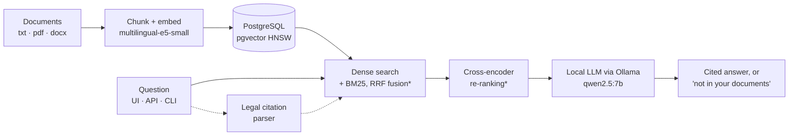

# raglab

[](https://github.com/VCLME/raglab/actions/workflows/ci.yml)
[](LICENSE)

**Private RAG you can measure.** raglab answers questions from your documents without them ever leaving your servers, proves its quality with before/after numbers on frozen benchmarks, and says "not in your documents" instead of inventing.

<!-- Demo GIF (20 s): record and save as docs/images/demo.gif, then replace the screenshot below with:
 -->


Website: **[vclme.github.io/raglab](https://vclme.github.io/raglab/)** · Technical report (French): [PDF](docs/rapport/raglab-rapport.pdf) · Documentation (French): [docs/](docs/README.md)

---

## Why it matters

- **Your data stays on your infrastructure.** Documents, embeddings, the search index and the language model all run on your machines: PostgreSQL + pgvector, a local embedding model, Ollama for generation. No external API call, so contracts, patient files or case law never leave the building.
- **Quality is measured, not claimed.** Every component is kept only if it improves frozen benchmarks with passage-level ground truth. Generated answers are scored by a judge from another model family, whose own reliability was measured.
- **It says when it doesn't know.** The model answers only from retrieved passages, cites each one inline, and replies with a fixed "not in your documents" message when the context is insufficient.

Built for teams whose documents cannot go to a cloud API (legal, compliance, insurance, healthcare, public-sector suppliers) and for the tech leads who have to justify an AI choice with numbers.

---

## Results

Two frozen question sets: **PIAF** (500 French questions, 761 Wikipedia paragraphs) and **LexML** (277 Portuguese questions on the full text of 252 Brazilian federal laws). Each row adds one component to the previous one; *measuring* means the code exists but no run has been recorded yet.

<!-- results:start -->
| Stage | What changes | PIAF Recall@5 | LexML Recall@5 | Article-number questions Recall@5 | Search latency p50 | Faithfulness (PIAF / LexML) |
|---|---|---|---|---|---|---|
| Baseline v0 | original pipeline: dense search only (multilingual-e5-small, pgvector HNSW) | 0.878 | 0.426 | 6% | 3.7 s | 0.845 / 0.723 † |
| Embedder cache | + embedding model loaded once instead of per question (retrieval only, not judged; still approximate HNSW search) | 0.878 | 0.451 | 8% | 20 ms | not judged |
| Baseline v1 | + exact vector search per index (the shared HNSW index made recall depend on what else was in the database); answers generated from the top 5 and judged on full chunks (official baseline) | 0.878 | 0.466 | 9% | 23 ms | 0.930 / 0.903 |
| Hybrid search (9.2) | + BM25 keyword search in PostgreSQL, fused with dense results (RRF) | 0.900 | 0.498 | 9% | 43 ms | 0.915 / 0.888 |
| BM25 only (9.2 · comparison) | BM25 keyword search alone, no embedding (comparison point for 9.2, not kept) | 0.838 | 0.477 | 6% | 7 ms | not judged |
| Re-ranking (9.3) | + cross-encoder bge-reranker-v2-m3 on the fused candidates | 0.966 | 0.596 | 9% | 461 ms | 0.905 / 0.853 |
| Dense + re-ranking (9.3 · comparison) | cross-encoder on dense candidates only, no BM25 (comparison point for 9.3, retrieval only) | 0.952 | 0.545 | 7% | 409 ms | not judged |
| Citation resolver (9.3b · comparison) | dense search + legal citations: "art. N da Lei X" is parsed, search is restricted to that law and the cited article is pinned first (comparison point, no BM25 or re-ranking) | 0.878 | 0.697 | 75% | 26 ms | 0.930 / 0.842 |
| Full pipeline (judged) | hybrid search + re-ranking + citation resolver (current default) | 0.966 | 0.816 | 72% | 635 ms | 0.907 / 0.895 |
| Sorted re-ranking batches (default) | + re-ranking pairs sorted by length before batching: same scores, less padding (retrieval only, not judged) | 0.966 | 0.816 | 72% | 537 ms | not judged |
| Fast re-ranking (option) | 20 re-ranking candidates instead of 40 (latency option, retrieval only) | 0.964 | 0.805 | 73% | 453 ms | not judged |
| 30 candidates (comparison) | 30 re-ranking candidates (latency sweep point, retrieval only) | 0.966 | 0.801 | 72% | 556 ms | not judged |

*Generated by `python scripts/build_site.py --readme` from [`benchmarks/results/`](benchmarks/results/). Search latency is embedding + vector search for one question, generation excluded. Faithfulness is scored on 100 answers per corpus by an independent judge (Gemma 4 26B-A4B). † Earlier judging protocol (answers from 10 chunks, judge reading truncated chunks), fixed before baseline-v1: not comparable.*
<!-- results:end -->

### The article-number problem

Lawyers ask "what does art. 49 of Law 8.078 say?". At baseline, dense retrieval put the right passage in the top five for **only 6% of the 97 LexML questions that cite an article number** (Recall@5 0.062, `baseline-v0`; 9% in the official `baseline-v1`), against 75% for questions naming an acronym or entity. Embeddings capture meaning, not identifiers: "art. 49" and "art. 94" look almost the same to them. Hybrid search and re-ranking did not help (still 9%): BM25 finds the right law but not the right article, since "art. 2" appears in every law.

A citation is structured data, not natural language, so raglab now reads it as such: it parses "art. 49 da Lei nº 8.078", restricts search to that law and pins the cited article first. Article-number questions went from **9% to 72%** in the full pipeline (+61 questions won, 0 lost, p < 0.001), and the method was checked on 72 questions never looked at while tuning it (8% to 72%). Over all 277 LexML questions, Recall@5 went from 0.466 to 0.816 and answer correctness from 0.45 to 0.60, with faithfulness unchanged. Method and limits: [docs/citations.md](docs/citations.md).

---

## Try it

Needs Docker. A GPU is optional.

```bash
git clone https://github.com/VCLME/raglab.git && cd raglab
docker compose up -d postgres ollama adminer neo4j
docker compose --profile app up -d api frontend
docker compose exec ollama ollama pull qwen2.5:7b
```

Then open the UI at <http://localhost:8081>: Expert → Corpus to add a folder of `.txt` / `.pdf` / `.docx`, Indexation to build an index, then Chat. The API is documented at <http://localhost:8000/docs>.

With an Nvidia GPU (`nvidia-container-toolkit`), start Ollama with the override: `docker compose -f docker-compose.yml -f docker-compose.gpu.yml up -d ollama`.

Command line, after `pip install -e .[dev]` and copying `.env.example` to `.env`:

```bash
raglab db init
raglab ingest data/documents --corpus demo
raglab index --corpus demo --strategy traditional
raglab query "What does the contract say about maintenance?" --corpus demo
```

---

## How it's built



<sub>Default pipeline: legal citations resolved first, then hybrid search (BM25 + dense, RRF) and cross-encoder re-ranking, the best measured configuration. Without a GPU, default re-ranking is skipped (it would take seconds on CPU) and the response says so. The Docker `api` container ships without a GPU and turns re-ranking off; set `RAGLAB_DEFAULT_RERANK=false` and `RAGLAB_DEFAULT_RETRIEVAL_MODE=dense` for the fastest path (~25-40 ms search instead of ~0.5 s).</sub>

One line per component, with its measured effect:

- **Passage-level benchmarks** (9.1): frozen question sets, full corpus indexed, a hit counts only if the chunk overlaps the exact answer passage. This is what makes every line below measurable.
- **Embedder cache**: the embedding model was reloaded from disk for every question; loading it once took search latency from 3.7 s to 20 ms p50 on PIAF.
- **Exact vector search**: one HNSW index was shared by every index in the database; once a corpus had been indexed several times, its duplicate vectors and the post-search filter made recall depend on the rest of the database (Recall@5 0.09 to 0.63 for two copies of PIAF, 0.91 exact on the same 150 questions). Exact search over the selected index takes 11-25 ms p50 at this scale and is now the default (`baseline-v1`); HNSW stays available for large corpora.
- **Hybrid BM25 + RRF** (9.2): keyword search in PostgreSQL, fused with dense results. Effect: PIAF Recall@10 0.90 to 0.94 and LexML 0.50 to 0.56 (significant), Recall@5 not significant; +20 ms search.
- **Cross-encoder re-ranking** (9.3): bge-reranker-v2-m3 re-scores the 40 fused candidates. Effect: PIAF Recall@5 0.88 to 0.97, LexML 0.47 to 0.60, significant on both (paired tests in [docs/reranking.md](docs/reranking.md)); costs ~0.6 s of search latency on a laptop GPU, over the 200 ms budget.
- **Legal citation resolver**: parses "art. N da Lei X", restricts search to that law, pins the article. Effect: article-number questions 9% to 72%, LexML Recall@5 0.60 to 0.82 on top of re-ranking ([docs/citations.md](docs/citations.md)).
- **Hardened API** (9.5): streamed answers (SSE), per-stage timeouts, request ids, optional API key, `/health` and `/ready`. Not a quality brick; no benchmark effect expected.
- **Observability** (9.6): `/metrics` for Prometheus (per-stage latency, top-1 score, tokens/s, cache hits, abstentions, skipped re-ranking), a versioned Grafana dashboard (`docker compose --profile obs up -d`, <http://127.0.0.1:3000>) and `raglab experiment drift` (KS test on scores between two indexes or periods). Cost: +0.17% on a simulated query. Details and dashboard screenshot (French): [docs/observabilite.md](docs/observabilite.md).

Stack: Python 3.12, FastAPI, SQLAlchemy, PostgreSQL 16 + pgvector 0.8, transformers, Ollama, React + Vite. Optional Neo4j graph store for comparison.

---

## How it's measured

1. **Frozen questions**: 500 PIAF and 277 LexML questions are committed in [`benchmarks/`](benchmarks/), sampled with a fixed seed, never regenerated between runs.
2. **Full haystack**: the whole corpus is indexed, so the answer has to be found among thousands of chunks, not among the sampled questions' own paragraphs.
3. **Passage-level relevance**: each question carries the character span of its answer; the right law but the wrong article is a miss.
4. **Independent, calibrated judge**: answers from qwen2.5:7b are scored by Gemma 4 26B-A4B; on 150 answers with known verdicts it recognised 90% of faithful answers and caught 97% of invented details.
5. **One change per run**: each run file records its exact command, commit, models and hardware ([`benchmarks/results/`](benchmarks/results/)).

Details (French): [protocol](docs/benchmarks/protocole.md) · [judges and calibration](docs/benchmarks/juges.md) · [baseline](docs/benchmarks/baseline.md).

---

## Limits

- Benchmarked on two corpora (French Wikipedia, Brazilian federal law). Your documents may behave differently, which is why the benchmark tooling ships with the pipeline.
- LexML questions were written by a model (Qwen3.6-35B-A3B), then filtered automatically and spot-checked by hand (40 reviewed, 23 of 300 rejected).
- Judge calibration is French-only and uses synthetic errors: an optimistic bound on the judge's reliability.
- No OCR for scanned PDFs; ingestion and indexing run synchronously in the API, without a job queue.
- Measured on one laptop GPU (RTX 3070 Ti, 8 GB); latency will differ on your hardware.

## What I'd do next

- Record `baseline-v1`, hybrid and re-ranking runs and publish them in the table above.
- Query routing and calibrated abstention (9.4), measured on 80 questions the corpora cannot answer.
- A weekly quality gate that fails when retrieval regresses (9.7).
- Run the same benchmark on a client's own documents before any deployment.

---

## Documentation

Detailed documentation is in French: **[docs/README.md](docs/README.md)** (run, measure, extend, operate), and the [technical report](docs/rapport/README.md). The site is built from [`site/`](site/) by `python scripts/build_site.py`.

## Licence

[MIT](LICENSE) © Luc Melaye
