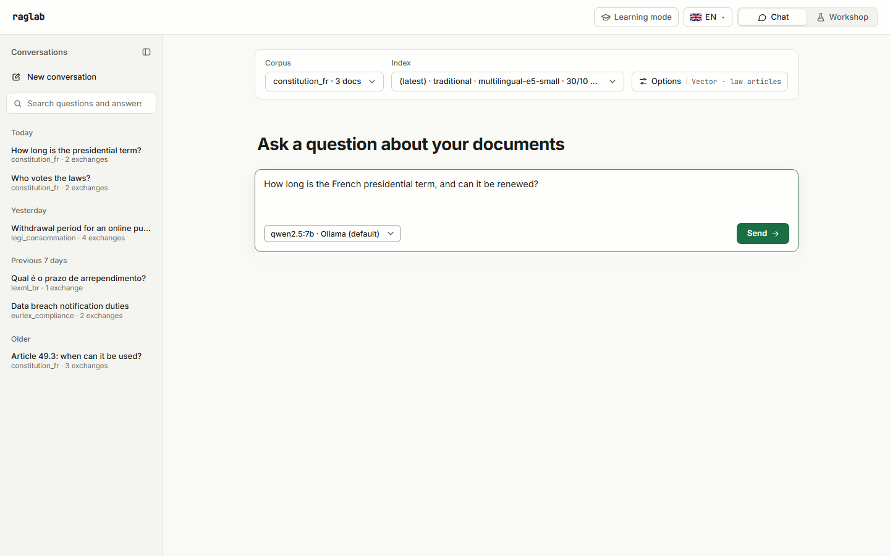
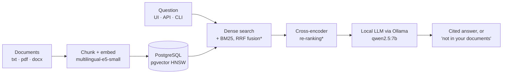

# raglab

[](https://github.com/VCLME/raglab/actions/workflows/ci.yml)
[](LICENSE)

**Private RAG you can measure.** raglab answers questions from your documents without them ever leaving your servers, proves its quality with before/after numbers on frozen benchmarks, and says "not in your documents" instead of inventing.

<!-- Demo GIF (20 s): record and save as docs/images/demo.gif, then replace the screenshot below with:
 -->


Website: **[vclme.github.io/raglab](https://vclme.github.io/raglab/)** · Technical report (French): [PDF](docs/rapport/raglab-rapport.pdf) · Documentation (French): [docs/](docs/README.md)

---

## Why it matters

- **Your data stays on your infrastructure.** Documents, embeddings, the search index and the language model all run on your machines: PostgreSQL + pgvector, a local embedding model, Ollama for generation. No external API call, so contracts, patient files or case law never leave the building.
- **Quality is measured, not claimed.** Every component is kept only if it improves frozen benchmarks with passage-level ground truth. Generated answers are scored by a judge from another model family, whose own reliability was measured.
- **It says when it doesn't know.** The model answers only from retrieved passages, cites each one inline, and replies with a fixed "not in your documents" message when the context is insufficient.

Built for teams whose documents cannot go to a cloud API (legal, compliance, insurance, healthcare, public-sector suppliers) and for the tech leads who have to justify an AI choice with numbers.

---

## Results

Two frozen question sets: **PIAF** (500 French questions, 761 Wikipedia paragraphs) and **LexML** (277 Portuguese questions on the full text of 252 Brazilian federal laws). Each row adds one component to the previous one; *measuring* means the code exists but no run has been recorded yet.

<!-- results:start -->
| Stage | What changes | PIAF Recall@5 | LexML Recall@5 | Article-number questions Recall@5 | Search latency p50 | Faithfulness (PIAF / LexML) |
|---|---|---|---|---|---|---|
| Baseline v0 | original pipeline: dense search only (multilingual-e5-small, pgvector HNSW) | 0.878 | 0.426 | 6% | 3.7 s | 0.845 / 0.723 |
| Embedder cache | + embedding model loaded once instead of per question (retrieval only, not judged) | 0.878 | 0.451 | 8% | 20 ms | not judged |
| Baseline v1 | + top-k always filled when several indexes share the database (official baseline) | *measuring* | *measuring* | *measuring* | *measuring* | *measuring* |
| Hybrid search (phase 9.2, in review) | + BM25 keyword search in PostgreSQL, fused with dense results (RRF) | *measuring* | *measuring* | *measuring* | *measuring* | *measuring* |
| Re-ranking (phase 9.3, in review) | + cross-encoder bge-reranker-v2-m3 on the fused candidates | *measuring* | *measuring* | *measuring* | *measuring* | *measuring* |

*Generated by `python scripts/build_site.py --readme` from [`benchmarks/results/`](benchmarks/results/). Search latency is embedding + vector search for one question, generation excluded. Faithfulness is scored on 100 answers per corpus by an independent judge (Gemma 4 26B-A4B).*
<!-- results:end -->

### The article-number problem

Lawyers ask "what does art. 49 of Law 8.078 say?". At baseline, dense retrieval put the right passage in the top five for **only 6% of the 97 LexML questions that cite an article number** (Recall@5 0.062, `baseline-v0`), against 75% for questions naming an acronym or entity. Embeddings capture meaning, not identifiers: "art. 49" and "art. 94" look almost the same to them. Hybrid search (BM25 keyword matching fused with dense results, phase 9.2) targets exactly this; its effect is being measured on the same questions and will land in the table above, whatever it turns out to be.

---

## Try it

Needs Docker. A GPU is optional.

```bash
git clone https://github.com/VCLME/raglab.git && cd raglab
docker compose up -d postgres ollama adminer neo4j
docker compose --profile app up -d api frontend
docker compose exec ollama ollama pull qwen2.5:7b
```

Then open the UI at <http://localhost:8081>: Expert → Corpus to add a folder of `.txt` / `.pdf` / `.docx`, Indexation to build an index, then Chat. The API is documented at <http://localhost:8000/docs>.

With an Nvidia GPU (`nvidia-container-toolkit`), start Ollama with the override: `docker compose -f docker-compose.yml -f docker-compose.gpu.yml up -d ollama`.

Command line, after `pip install -e .[dev]` and copying `.env.example` to `.env`:

```bash
raglab db init
raglab ingest data/documents --corpus demo
raglab index --corpus demo --strategy traditional
raglab query "What does the contract say about maintenance?" --corpus demo
```

---

## How it's built



<sub>* in review (phases 9.2 and 9.3); the merged pipeline is dense search only.</sub>

One line per component, with its measured effect:

- **Passage-level benchmarks** (9.1): frozen question sets, full corpus indexed, a hit counts only if the chunk overlaps the exact answer passage. This is what makes every line below measurable.
- **Embedder cache**: the embedding model was reloaded from disk for every question; loading it once took search latency from 3.7 s to 20 ms p50 on PIAF.
- **Complete top-k**: pgvector iterative scan so a filtered search always returns k chunks when several indexes share the database. Effect: *measuring* (`baseline-v1`).
- **Hybrid BM25 + RRF** (9.2, in review): keyword search in PostgreSQL, fused with dense results. Effect: *measuring*.
- **Cross-encoder re-ranking** (9.3, in review): bge-reranker-v2-m3 on the fused candidates. Effect: *measuring*.
- **Hardened API** (9.5): streamed answers (SSE), per-stage timeouts, request ids, optional API key, `/health` and `/ready`. Not a quality brick; no benchmark effect expected.

Stack: Python 3.12, FastAPI, SQLAlchemy, PostgreSQL 16 + pgvector 0.8, transformers, Ollama, React + Vite. Optional Neo4j graph store for comparison.

---

## How it's measured

1. **Frozen questions**: 500 PIAF and 277 LexML questions are committed in [`benchmarks/`](benchmarks/), sampled with a fixed seed, never regenerated between runs.
2. **Full haystack**: the whole corpus is indexed, so the answer has to be found among thousands of chunks, not among the sampled questions' own paragraphs.
3. **Passage-level relevance**: each question carries the character span of its answer; the right law but the wrong article is a miss.
4. **Independent, calibrated judge**: answers from qwen2.5:7b are scored by Gemma 4 26B-A4B; on 150 answers with known verdicts it recognised 90% of faithful answers and caught 97% of invented details.
5. **One change per run**: each run file records its exact command, commit, models and hardware ([`benchmarks/results/`](benchmarks/results/)).

Details (French): [protocol](docs/benchmarks/protocole.md) · [judges and calibration](docs/benchmarks/juges.md) · [baseline](docs/benchmarks/baseline.md).

---

## Limits

- Benchmarked on two corpora (French Wikipedia, Brazilian federal law). Your documents may behave differently, which is why the benchmark tooling ships with the pipeline.
- LexML questions were written by a model (Qwen3.6-35B-A3B), then filtered automatically and spot-checked by hand (40 reviewed, 23 of 300 rejected).
- Judge calibration is French-only and uses synthetic errors: an optimistic bound on the judge's reliability.
- No OCR for scanned PDFs; ingestion and indexing run synchronously in the API, without a job queue.
- Measured on one laptop GPU (RTX 3070 Ti, 8 GB); latency will differ on your hardware.

## What I'd do next

- Record `baseline-v1`, hybrid and re-ranking runs and publish them in the table above.
- Query routing and calibrated abstention (9.4), measured on 80 questions the corpora cannot answer.
- Observability: Prometheus metrics, Grafana dashboard, drift report (9.6).
- A weekly quality gate that fails when retrieval regresses (9.7).
- Run the same benchmark on a client's own documents before any deployment.

---

## Documentation

Detailed documentation is in French: **[docs/README.md](docs/README.md)** (run, measure, extend, operate), and the [technical report](docs/rapport/README.md). The site is built from [`site/`](site/) by `python scripts/build_site.py`.

## Licence

[MIT](LICENSE) © Luc Melaye
