# raglab

[](https://github.com/VCLME/raglab/actions/workflows/ci.yml)

**Un banc d'essai RAG local pour comparer stratégies de chunking, modèles d'embedding et stratégies de retrieval sur tes propres documents.**

PostgreSQL + pgvector pour le stockage. Ollama pour la génération locale. React + FastAPI pour l'UI. Tout tourne sur ta machine, sans appel externe.


*Mode Chat : choix du corpus, de l'index, du LLM. Les suggestions viennent directement du dataset de validation associé au corpus — ici PIAF pour `piaf_fr`.*

---

## Pourquoi raglab

Quand tu montes un pipeline RAG, les décisions qui comptent sont :

- Quelle **stratégie de chunking** ? (`traditional` fenêtre fixe, `slide` glissant, `late` avec contexte)
- Quel **modèle d'embedding** et quelle dimension ?
- Quel **top-K** et quels filtres de retrieval ?
- Quel **LLM** pour la génération, avec quel prompt ?

raglab te laisse lancer chaque combinaison, la mesurer contre un jeu de vérité terrain (PIAF, datasets custom, LexML), visualiser les Recall@K / MRR côte à côte et comparer.

Plus de détails : **[docs/base-idea.md](docs/base-idea.md)**.

---

## Aperçu de l'UI

La nav Expert est groupée en trois familles repliables (Vecteur / Graphe / LLM), avec Dashboard, Corpus et Benchmarks au top-level :

<table>
<tr>
<td><a href="docs/images/expert-dashboard.png">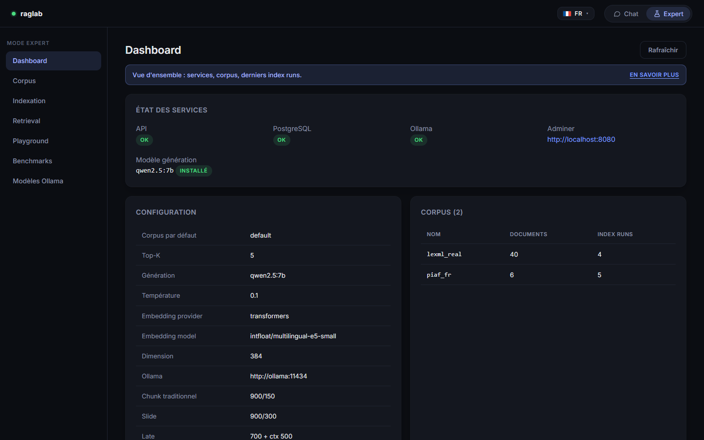</a></td>
<td><a href="docs/images/expert-corpus.png">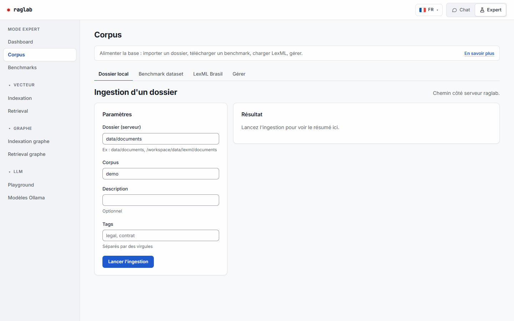</a></td>
</tr>
<tr>
<td><b>Dashboard</b> — santé des services, modèle par défaut, corpus et derniers index runs.</td>
<td><b>Corpus</b> — ingère un dossier local, télécharge un benchmark (PIAF), charge LexML Brasil, supprime un corpus.</td>
</tr>
<tr>
<td><a href="docs/images/expert-index.png">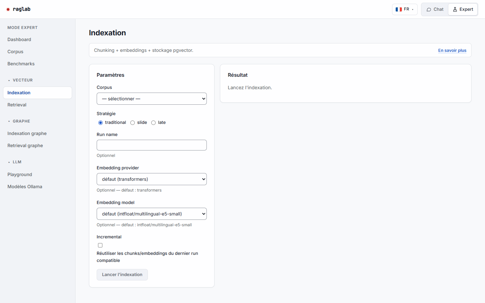</a></td>
<td><a href="docs/images/expert-retrieval.png">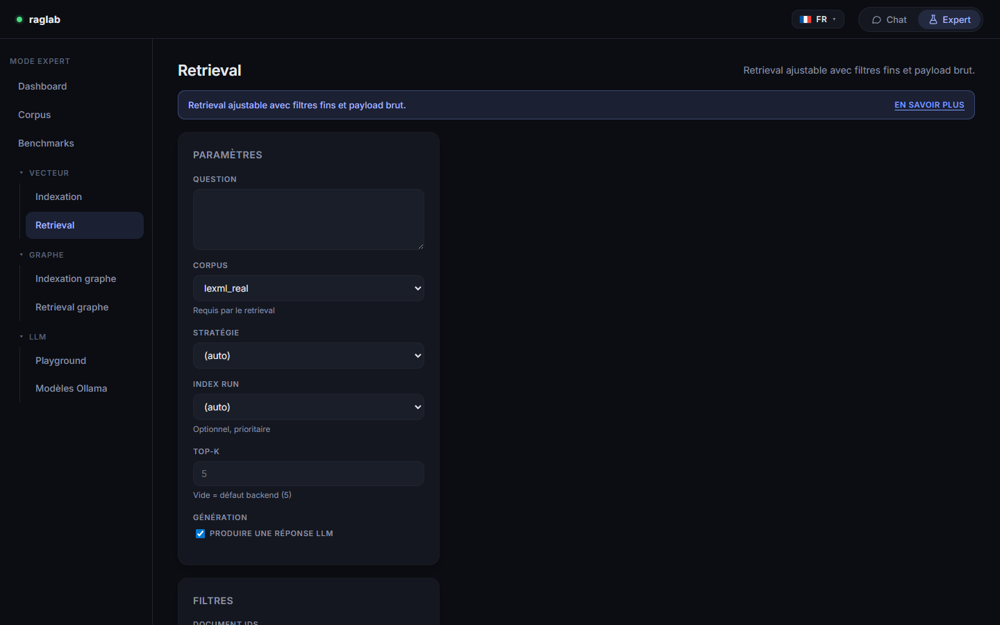</a></td>
</tr>
<tr>
<td><b>Indexation</b> — chunk + embed + stocke dans pgvector. Une stratégie × un embedding = un index run.</td>
<td><b>Retrieval</b> — version détaillée du Chat avec filtres fins (tags, file_name, metadata) et payload JSON brut.</td>
</tr>
<tr>
<td><a href="docs/images/expert-playground.png">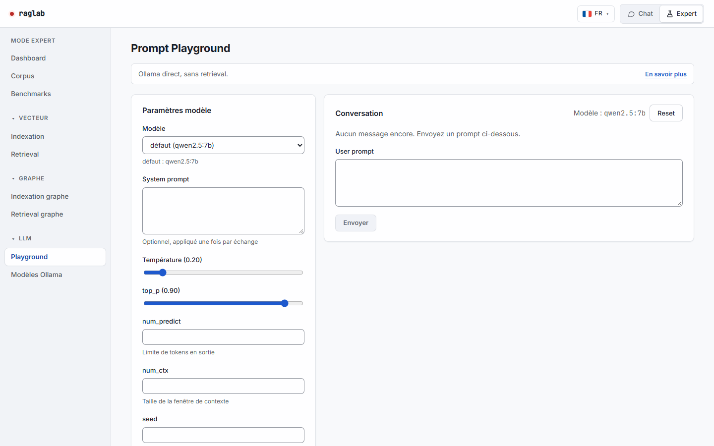</a></td>
<td><a href="docs/images/expert-ollama.png">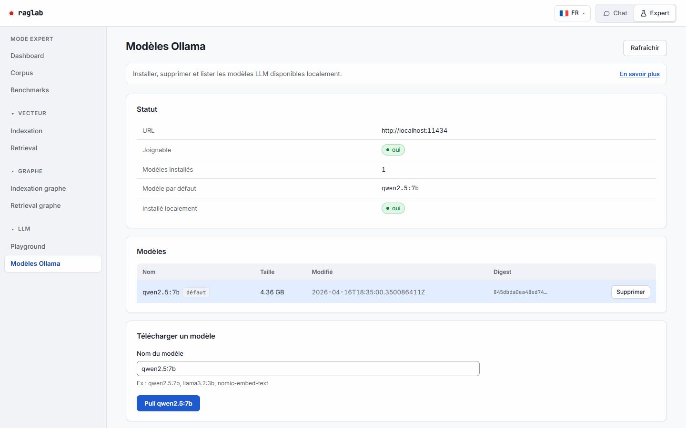</a></td>
</tr>
<tr>
<td><b>Playground</b> — chat direct avec Ollama, sans retrieval. Calibrer un modèle, tester un system prompt.</td>
<td><b>Modèles Ollama</b> — statut, liste, pull, suppression des modèles LLM installés localement.</td>
</tr>
<tr>
<td><a href="docs/images/expert-graph-index.png">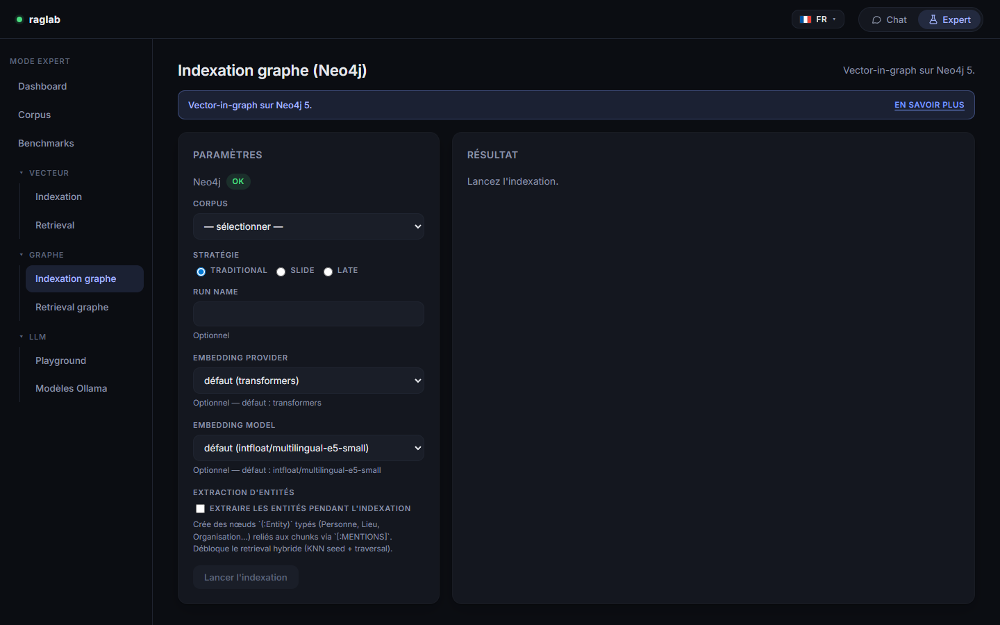</a></td>
<td><a href="docs/images/expert-graph-query.png">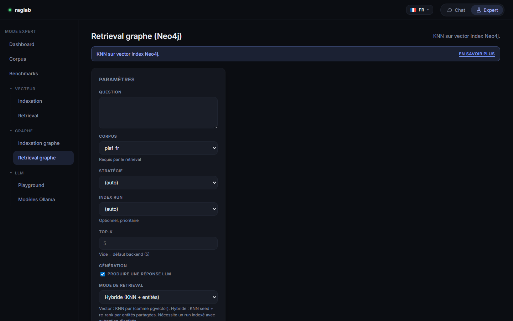</a></td>
</tr>
<tr>
<td><b>Indexation graphe (Neo4j)</b> — chunks écrits comme <code>(:Chunk)</code> avec <code>embedding_d{N}</code>, un vector index Neo4j 5 par dimension. Comparable direct avec pgvector.</td>
<td><b>Retrieval graphe (Neo4j)</b> — KNN via <code>db.index.vector.queryNodes</code>. Les filtres corpus / file_name / source_path / tags sont supportés ; metadata_equals arrive en phase 8.2.</td>
</tr>
</table>

### Benchmarks

La page Benchmarks a trois onglets pour le cycle complet évaluer → mesurer → itérer :

| Lancer | Historique | Créer un dataset |
|---|---|---|
| [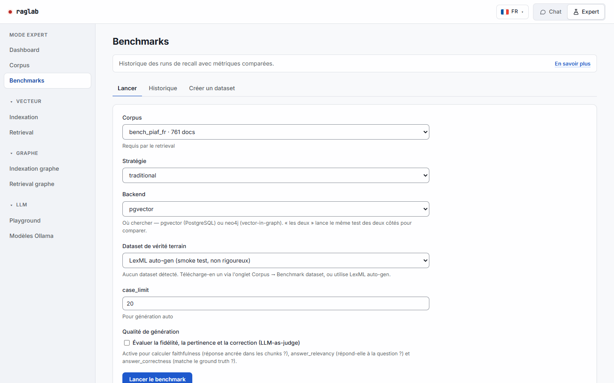](docs/images/expert-benchmarks-launch.png) | [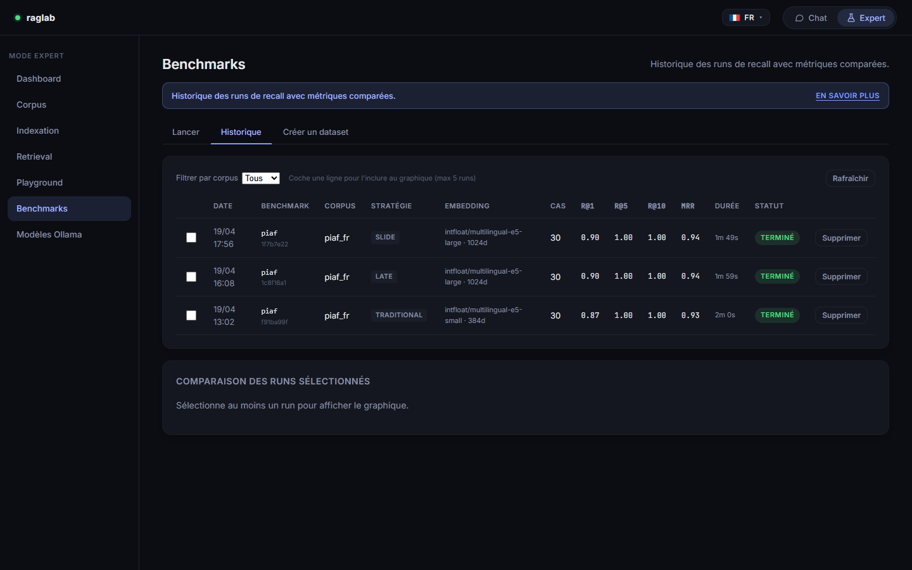](docs/images/expert-benchmarks-history.png) | [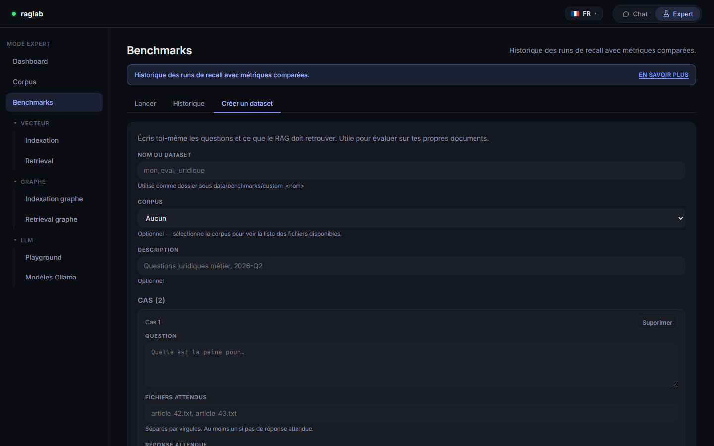](docs/images/expert-benchmarks-custom.png) |
| Choisis un corpus, une stratégie et un dataset de vérité terrain. Le dropdown auto-détecte les datasets présents sur disque et prévient quand corpus et dataset ne matchent pas. | Coche jusqu'à 5 runs pour comparer R@1 / R@5 / R@10 / MRR sur un graphe partagé. Clique une ligne pour voir le détail cas par cas. Delete pour purger un run foiré. | Écris tes propres questions + fichiers attendus (+ réponse optionnelle). Sauvegardé en `data/benchmarks/custom_<nom>/ground_truth.jsonl`. Apparaît immédiatement dans l'onglet Lancer. |

---

## Observabilité

`/metrics` expose les latences par étape, le score top-1, le débit de génération, les taux de hit des caches et d'abstention ; `docker compose --profile obs up -d` lance Prometheus et Grafana (tableau de bord versionné, lecture anonyme sur http://127.0.0.1:3000). `raglab experiment drift` compare deux index ou deux périodes (test KS sur les scores, écarts RAGAS). Détails : [docs/observabilite.md](docs/observabilite.md).

<!-- Capture Grafana à prendre avec la stack lancée sur des requêtes réelles : docs/images/grafana-overview.png -->
> *Capture du tableau de bord Grafana à venir.*

---

## Démarrage rapide (Docker)

```bash
docker compose up -d postgres ollama adminer neo4j
docker compose --profile app up -d api frontend
docker compose exec ollama ollama pull qwen2.5:7b
```

Puis :

- **UI** : [http://localhost:8081](http://localhost:8081)
- **API Swagger** : [http://localhost:8000/docs](http://localhost:8000/docs)
- **Adminer** (explorateur PostgreSQL) : [http://localhost:8080](http://localhost:8080) — serveur `postgres`, user/pwd `raglab`, base `raglab`
- **Neo4j Browser** : [http://localhost:7474](http://localhost:7474) — user `neo4j` / pwd `raglab_neo4j` (store graphe en cours, voir [docs/roadmap.md](docs/roadmap.md))

Pour ingérer tes premiers documents : Expert → Corpus → Dossier local, pointe sur un dossier contenant des `.txt`, `.pdf`, `.docx`. Puis Indexation pour créer un index run, puis Chat pour interroger.

### Version CLI

```bash
raglab db init
raglab ingest data/documents --corpus demo
raglab index --corpus demo --strategy traditional
raglab query "Que dit le document sur la maintenance ?" --corpus demo
raglab experiment recall --corpus demo --strategy traditional \
  --dataset-path data/benchmarks/piaf/ground_truth.jsonl
```

Installation Python : `pip install -e .[dev]` après `copy .env.example .env`.

---

## Ce que tu peux mesurer

| Axe | Options disponibles |
|---|---|
| **Chunking** | `traditional` (900/150), `slide` (900/300), `late` (700 focal + 500 ctx) |
| **Embedding** | n'importe quel modèle transformers ou `nomic-embed-text` via Ollama. Dimensions variables supportées (pgvector ≥ 0.7, un index HNSW partiel par dim) |
| **Retrieval** | top-K configurable, filtres par tag, file_name, source_path, metadata JSON |
| **Generation** | tout modèle Ollama (qwen2.5:7b par défaut). Température, top_p, num_ctx, seed, options avancées |
| **Ground truth** | PIAF (≈30k Q/R français), FQuAD (si disponible), LexML auto-gen (smoke test), ou ton propre dataset via l'onglet « Créer un dataset » |
| **Metrics** | Recall@1/5/10, MRR, Precision@K, mean_first_relevant_rank, durée |

---

## Corpus LexML Brasil

Pipeline tout-en-un qui collecte des fiches juridiques publiques, ingère, indexe :

```bash
raglab lexml load --corpus lexml_real --strategy traditional --page-limit 1
```

Détails (limites de taille, sidecars metadata, reprise de collecte) : **[docs/real-rag-lexml-load.md](docs/real-rag-lexml-load.md)**.

---

## GPU Nvidia (optionnel)

Override Compose prêt pour `nvidia-container-toolkit` :

```bash
docker compose -f docker-compose.yml -f docker-compose.gpu.yml up -d ollama
```

Gain observé sur RTX 3070 Ti Laptop avec `qwen2.5:7b` Q4 : **~10.7 tok/s CPU → ~38 tok/s GPU (3.6×)**. VRAM ≈ 4.7 GiB.

---

## Paramètres par défaut

- génération : `qwen2.5:7b` (fallback explicite si contexte insuffisant, citations `[Rank N]` inline)
- embeddings : `intfloat/multilingual-e5-small` (384d)
- top-K : 5
- chunking : voir tableau ci-dessus

---

## Qualité du code

Chaque push et chaque pull request passent par la CI GitHub Actions ([`.github/workflows/ci.yml`](.github/workflows/ci.yml)) :

- Python : `ruff check` (règles E, F, I, B, UP), `ruff format --check`, `mypy` sur `src/` et `pytest` (base de données et Ollama simulés, torch CPU)
- frontend : `tsc --noEmit` puis `vite build`
- build des images Docker de l'API et du frontend, sans push

En local, après `pip install -e .[dev]` :

```bash
ruff check . && ruff format --check . && mypy && pytest
```

---

## Documentation

- [docs/base-idea.md](docs/base-idea.md) — mission et axes de comparaison
- [docs/architecture.md](docs/architecture.md) — architecture logicielle
- [docs/technical-choices.md](docs/technical-choices.md) — choix techniques (pgvector, Ollama, etc.)
- [docs/data-model.md](docs/data-model.md) — modèle de données PostgreSQL
- [docs/experimentation-plan.md](docs/experimentation-plan.md) — plan d'expé rigoureux
- [docs/roadmap.md](docs/roadmap.md) — ce qui est livré, ce qui vient
- [docs/frontend-ui.md](docs/frontend-ui.md) — détail des pages React
- [docs/run-and-test.md](docs/run-and-test.md) — commandes pour lancer / tester / rejouer
- [docs/observabilite.md](docs/observabilite.md) — métriques Prometheus, Grafana, rapport de dérive

---

## Limites actuelles

- pas d'OCR pour PDF images
- pas de reranker (cross-encoder en roadmap)
- Neo4j est branché, l'indexation et le retrieval graphe sont fonctionnels (vector-in-graph, un vector index Neo4j 5 par dimension). Les filtres `metadata_equals` sur le store graphe et l'extraction d'entités arrivent en phase 8.2 — voir [docs/roadmap.md](docs/roadmap.md)
- l'API exécute ingest/index/lexml load en synchrone, sans file de jobs
- la collecte LexML V1 sauvegarde des fiches structurées, sans suivre encore les liens de texte intégral
