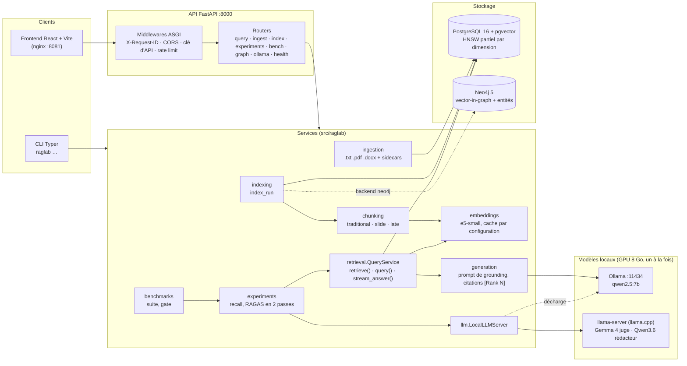
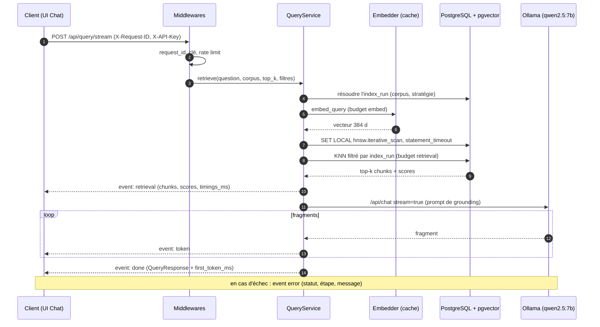
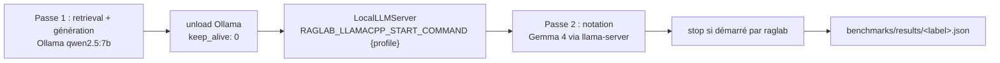

# Architecture de raglab

Ce document décrit le système tel qu'il est aujourd'hui (phase 9 en cours) : les composants, leurs responsabilités, le chemin d'une requête et la chaîne de mesure. Pour savoir *pourquoi* une technologie a été choisie, voir [technical-choices.md](technical-choices.md) ; pour le schéma de la base, [data-model.md](data-model.md) ; pour l'exploitation au quotidien, [exploitation.md](exploitation.md).

## 1. Vue d'ensemble

raglab est un RAG local qui sert deux usages avec le même code :

- **répondre** à des questions sur un corpus (UI Chat, `POST /api/query`, `raglab query`) ;
- **mesurer** chaque variante du pipeline sur des jeux figés (`raglab bench all`, `raglab gate`), pour ne garder une brique que si elle apporte un gain chiffré.

Tout tourne sur une seule machine : PostgreSQL + pgvector, Neo4j et Ollama dans Docker, llama.cpp sur l'hôte, l'API FastAPI et le frontend React dans Docker ou en local.

## 2. Composants

| Module | Rôle |
|---|---|
| `config.py` | Tous les réglages, préfixe `RAGLAB_`, lus depuis l'environnement ou `.env` (Pydantic Settings). Aucune limite ni URL n'est codée en dur ailleurs. |
| `ingestion/` | Lit `.txt`, `.pdf`, `.docx`, normalise le texte, calcule un checksum, lit un éventuel sidecar JSON de metadata. Un document déjà présent dans le corpus est mis à jour, pas dupliqué. |
| `chunking/` | Trois stratégies interchangeables derrière une factory. Elles servent de référence de comparaison et **ne sont pas modifiées** pendant la phase 9. |
| `embeddings/` | Provider `transformers` (défaut `intfloat/multilingual-e5-small`, 384 d, préfixes `query: ` / `passage: `) ou `ollama`. Un provider chargé est gardé en mémoire par configuration. |
| `indexing/` | Crée un `index_run` (corpus × stratégie × espace d'embedding), chunke, vectorise, persiste ; mode incrémental qui réutilise les chunks des documents inchangés. |
| `stores/vector/` | Recherche KNN pgvector avec filtres (document, fichier, chemin, tags, metadata). |
| `retrieval/` | `QueryService` : résout l'index run, construit l'embedder qui correspond à son espace, cherche, génère. |
| `generation/` | Client Ollama (`/api/chat`, avec ou sans `stream`), prompt de grounding, réponse de repli quand le contexte est vide. |
| `graph/` | Store Neo4j : chunks en nœuds `(:Chunk)` avec embedding, un vector index par dimension, extraction d'entités (LLM ou spaCy), recherche hybride vecteur + entités, sous-graphe pour l'UI. |
| `experiments/` | Benchmark de recall, juges RAGAS, calibration des juges, runner multi-stratégies. |
| `benchmarks/` | Loaders de jeux (PIAF, FQuAD, LexML), `suite.run_all` (`raglab bench all`), porte de qualité (`gate`). |
| `lexml/` | Collecte LexML : fiches historiques et texte intégral des lois fédérales (planalto.gov.br), génération et relecture des questions. |
| `llm/` | Client compatible OpenAI pour llama-server et `LocalLLMServer`, qui orchestre le GPU. |
| `ollama/` | Pilotage d'Ollama (statut, liste, pull, suppression) et erreurs Ollama typées. |
| `api/` | Application FastAPI, middlewares, routers, schémas, correspondance erreur → statut HTTP (`errors.describe_error`). |
| `cli.py` | Point d'entrée `raglab` (Typer). |

## 3. Ingestion, chunking, indexation

1. `raglab ingest <dossier> --corpus <nom>` (ou `POST /api/ingest`) lit chaque fichier compatible, normalise le texte et l'enregistre avec son checksum (création ou mise à jour). Les fichiers vides sont ignorés. Les metadata d'un sidecar JSON alimentent les filtres `tags` et `metadata_eq`.
2. `raglab index --corpus <nom> --strategy <stratégie>` crée un `index_run`. Paramètres par défaut :

   | Stratégie | Découpage |
   |---|---|
   | `traditional` | 900 caractères, chevauchement 150 |
   | `slide` | fenêtre 900, pas 300 |
   | `late` | chunk focal 700, embedding calculé avec 500 caractères de contexte de chaque côté |

3. Chaque chunk est vectorisé dans un `embedding_space` (provider, modèle, dimension, distance, préfixes). Plusieurs espaces de dimensions différentes coexistent dans la même colonne `vector` non dimensionnée ; un index HNSW **partiel** par dimension est créé à la volée (`m = 16`, `ef_construction = 64`, cosinus). Voir [data-model.md](data-model.md).
4. `IndexRun.config_json.backend` vaut `pgvector` ou `neo4j`. Avec le backend `neo4j`, les chunks restent dans Postgres pour l'audit et les embeddings vont dans Neo4j.

## 4. Embeddings et cache

`build_embedding_provider` garde un provider chargé par configuration (provider, modèle, dimension, appareil…) derrière un verrou : sous concurrence, le modèle est chargé une seule fois. Avant la phase 9, chaque requête rechargeait les poids d'e5-small depuis le disque et vérifiait les fichiers sur Hugging Face, ce qui rendait une requête RAG dépendante d'internet. `RAGLAB_EMBEDDING_CACHE=false` rétablit cet ancien comportement, uniquement pour le mesurer (`baseline-v0`).

À la requête, l'embedder est construit avec l'espace de l'index run interrogé, pas avec la configuration courante : interroger un index fait avec un autre modèle reste correct.

## 5. Recherche pgvector et scan HNSW itératif

L'index HNSW est partagé par tous les index runs de même dimension. Sans précaution, pgvector lit `hnsw.ef_search` candidats (40) puis applique le filtre `index_run_id` : avec plusieurs corpus dans la base, une question pouvait revenir avec moins de `top_k` chunks, voire aucun.

Correctif (pgvector ≥ 0.8) : dans la transaction de recherche, `SET LOCAL hnsw.iterative_scan = strict_order` et `hnsw.ef_search = max(40, top_k)`. pgvector continue de parcourir le graphe jusqu'à remplir le top-k filtré, dans l'ordre exact des distances. `RAGLAB_HNSW_ITERATIVE_SCAN=false` désactive le correctif (mesure `baseline-v0`).

La recherche s'exécute sous un `statement_timeout` Postgres égal à `RAGLAB_RETRIEVAL_TIMEOUT_SECONDS`, posé puis restauré autour de la requête.

## 6. Génération

`OllamaGenerator` envoie à `/api/chat` un prompt de grounding : la réponse doit s'appuyer uniquement sur les chunks fournis et les citer en ligne (`[Rank N]`). Sans contexte, la réponse est `RAGLAB_GENERATION_NO_CONTEXT_ANSWER`. Le modèle par défaut est `qwen2.5:7b` (température 0,1) ; `llm_model` (API) ou `--llm-model` (CLI) en choisit un autre pour une requête.

## 7. Graphe Neo4j

**Graphe des renvois (9.9a)** : pour chaque index run pgvector, un graphe structuré construit à partir des chunks de PostgreSQL, sans vecteurs : `Document`, `Section`, `Chunk` (`PART_OF`, `NEXT`) et, pour les lois, `Law`, `Article`, `CITES`, `AMENDS`, `REVOKES`, extraits par règles. PostgreSQL reste la source de vérité ; le graphe se reconstruit à l'indexation quand Neo4j répond, ou par `raglab graph build`. Schéma, règles et précision mesurée : [graphe.md](graphe.md).

**Store à entités (phase 8, derrière `RAGLAB_ENTITY_GRAPH_ENABLED`)** : alternative à pgvector jamais mesurée, gardée pour mémoire, comparable sur les mêmes benchmarks (`backend: "neo4j"` dans `/api/experiments/recall`) :

- chaque chunk est un nœud `(:Chunk)` avec une propriété `embedding_d{N}`, relié à son document (`[:BELONGS_TO]`) et à son run (`[:FROM_RUN]`) ;
- un vector index Neo4j par dimension, interrogé par `db.index.vector.queryNodes` ;
- extraction d'entités optionnelle (`LLMEntityExtractor` via Ollama, ou spaCy) : `(:Entity {name, type})` et `[:MENTIONS]` ;
- mode `hybrid` : le score vecteur est combiné à la part d'entités partagées avec les meilleurs résultats (`entity_weight`, `seed_top_n`) ;
- `GET /api/graph/subgraph` renvoie le sous-graphe des chunks retrouvés pour la vue Cytoscape de l'UI.

Le filtre `metadata_equals` n'existe pas encore côté graphe (phase 8.2.3).

## 8. API

L'API (`src/raglab/api/`, détail dans [api-production.md](api-production.md)) réutilise les services ci-dessus sans logique propre.

- **Middlewares ASGI purs** (pas de `BaseHTTPMiddleware`, qui bufferiserait le streaming), dans l'ordre de traversée : `RequestIdMiddleware` (accepte ou génère `X-Request-ID`, le renvoie, l'attache à chaque ligne de log via une `ContextVar`, écrit la ligne d'accès `http.request`) → CORS → `ApiKeyRateLimitMiddleware` (`X-API-Key` ou `Authorization: Bearer`, limite de débit en mémoire par clé ou IP, 429 + `Retry-After`). `RAGLAB_API_KEY` vide = authentification désactivée.
- **Requête** : `POST /api/query` (réponse complète, inchangée pour la compatibilité) et `POST /api/query/stream` (SSE : `retrieval`, puis `token`…, puis `done` ou `error`).
- **Budgets par étape** : `embed` (`RAGLAB_EMBED_TIMEOUT_SECONDS`), `retrieval` (`statement_timeout`), `generation` (`RAGLAB_GENERATION_TIMEOUT_SECONDS`). Un dépassement renvoie un 504 qui nomme l'étape.
- **Erreurs** : `errors.describe_error` donne le statut et le message, pour les handlers d'exception comme pour l'événement SSE `error`. Erreurs Ollama typées : modèle absent 424, mémoire saturée 503 + `Retry-After`, injoignable 502, timeout 504.
- **Santé** : `/health` (liveness, ne touche aucune dépendance), `/ready` (Postgres, Ollama et modèle par défaut installé ; 503 sinon), `/api/health` (vue complète pour le Dashboard, Neo4j compris).

### Chemin d'une requête en streaming

## 9. Mesure : benchmarks et juges RAGAS

Méthode complète : [benchmarks/protocole.md](benchmarks/protocole.md), [benchmarks/juges.md](benchmarks/juges.md), [benchmarks/baseline.md](benchmarks/baseline.md).

- **Jeux figés** dans `benchmarks/` : PIAF (500 questions, 761 paragraphes indexés en entier), LexML texte intégral (277 questions typées sur 252 lois, corpus vérifié par manifeste SHA-256), questions hors périmètre pour l'abstention (`benchmarks/abstention/`, phase 9.4).
- **Pertinence au niveau du passage** : un chunk est pertinent s'il chevauche le passage attendu (`expected_spans`), quelle que soit la stratégie de chunking.
- **`raglab bench all --label <nom>`** (`benchmarks/suite.py`) : vérifie le corpus, ingère et indexe dans `bench_piaf_fr` / `bench_lexml_pt`, mesure Recall@k, MRR, latences par étape (p50/p95), puis génère et note les réponses des `--ragas-limit` premières questions. Le résultat (chiffres, machine, versions, empreintes de modèles, commande exacte) est écrit dans `benchmarks/results/<label>.json`.
- **Notation RAGAS en deux passes** : la boucle de retrieval génère les réponses avec qwen2.5 (Ollama) ; ensuite seulement, `LocalLLMServer` décharge Ollama (`keep_alive: 0`), démarre llama-server avec le profil du juge (Gemma 4 26B-A4B) si aucun serveur ne répond, note faithfulness, answer_relevancy et answer_correctness en JSON contraint, puis arrête le serveur s'il l'a démarré. Le générateur ne note jamais ses propres réponses.

## 10. Porte de qualité et CI

- **`raglab gate`** compare un résultat de `raglab bench all` aux planchers versionnés de `benchmarks/thresholds.json` (Recall@5, MRR, faithfulness par jeu) et sort en code 1 sous un plancher. Voir [portes-qualite.md](portes-qualite.md).
- **CI** (`.github/workflows/ci.yml`, à chaque push et PR) : `ruff check`, `ruff format --check`, `mypy`, `pytest` (base et Ollama simulés, torch CPU) ; `tsc --noEmit` et `vite build` pour le frontend ; build des images Docker API et frontend.
- **Porte hebdomadaire** (`.github/workflows/quality-gate.yml`, lundi 05:00 UTC et à la demande) : `raglab gate` sur le retrieval seul, sur CPU, avec un Postgres de service et les corpus en cache.

## 11. Décisions structurantes

- Le chunking est versionné par `index_run`, pas par document.
- Les embeddings appartiennent à un `embedding_space` ; la requête s'aligne sur celui de l'index interrogé.
- La génération n'est pas couplée au moteur de recherche (pgvector ou Neo4j).
- Une option de retrieval est exposée partout : CLI, API, UI (page Retrieval, mode expert).
- Une brique de la phase 9 reste derrière un drapeau tant qu'elle n'a pas montré de gain mesuré.
- Le GPU (8 Go) ne porte qu'un gros modèle à la fois ; l'orchestration est dans le code (`LocalLLMServer`), pas à la main.

## 12. Ce qui n'est pas encore là

- Retrieval hybride BM25 + RRF (9.2) et re-ranking cross-encoder (9.3) : PR ouvertes, pas encore fusionnées.
- Routeur de requête et abstention (9.4), observabilité Prometheus / Grafana (9.6) : en cours.
- Migrations Alembic : arrivent avec 9.2 ; aujourd'hui `raglab db init` crée les tables et applique les ajustements de schéma connus.
- Pas d'OCR pour les PDF image, pas de file de jobs : ingestion et indexation sont synchrones côté API.
