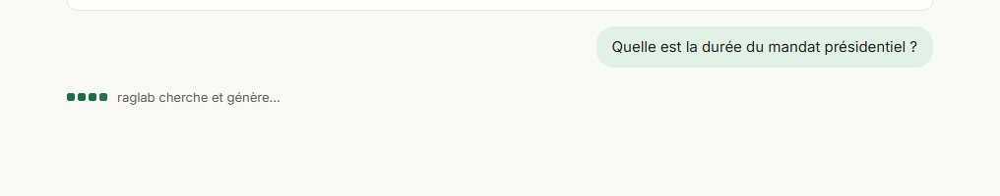
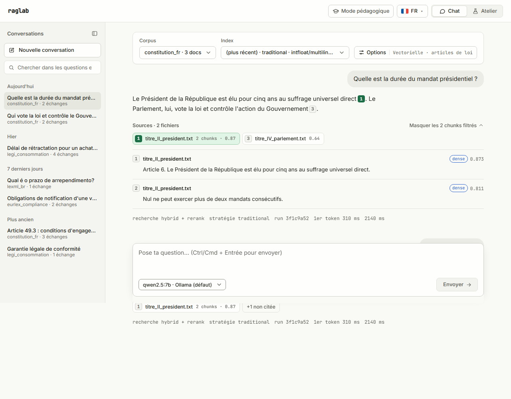
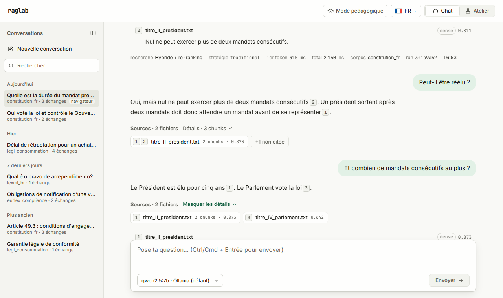

# Interface web raglab

raglab expose desormais une interface web pour piloter ingestion, indexation, retrieval, generation, collecte LexML et pilotage Ollama depuis un navigateur. L'interface est une couche additionnelle : la CLI `raglab` reste le mode d'emploi premier, l'UI reutilise les memes services Python via une API HTTP.

## Architecture

- **API** : FastAPI expose dans `src/raglab/api/`, servie par uvicorn. Les handlers appellent directement les services existants (`IngestionService`, `IndexingService`, `QueryService`, `OllamaService`, `LexMLLoadService`, `RecallBenchmarkService`). Aucune invocation de la CLI Typer en sous-processus.
- **Frontend** : application React + TypeScript + Vite dans `frontend/`. React Router pour les pages, `fetch` natif cote client, pas de dependance UI lourde. En production, bundle statique servi par nginx qui proxy `/api` vers le conteneur `api`.
- **Reutilisation** : aucun duplicata de logique metier. La methode `OllamaService.chat(...)` a ete ajoutee pour le banc d'essai Ollama (page Modèles), elle est aussi disponible en Python pur.

Ports :

| Service | Port | URL |
| --- | --- | --- |
| PostgreSQL | 5432 | — |
| Adminer | 8080 | http://localhost:8080 |
| Ollama | 11434 | http://localhost:11434 |
| API raglab | 8000 | http://localhost:8000 (Swagger sur `/docs`) |
| Frontend (prod) | 8081 | http://localhost:8081 |
| Frontend (dev) | 5173 | http://localhost:5173 |

## Demarrage

### Mode Docker complet (recommande pour une demo)

```bash
docker compose up -d postgres ollama adminer
docker compose --profile app up -d api frontend
```

Puis :

- Frontend : http://localhost:8081
- Swagger de l'API : http://localhost:8000/docs
- Adminer : http://localhost:8080

Arret : `docker compose --profile app down` puis `docker compose down`.

### Mode dev local (boucle courte sur le frontend)

Dans un terminal :

```bash
docker compose up -d postgres ollama
raglab db init
raglab serve --dev
```

Dans un autre terminal :

```bash
cd frontend
npm install
npm run dev
```

Ouvrir http://localhost:5173. Le serveur Vite proxy `/api` vers `http://localhost:8000` (voir `frontend/vite.config.ts`).

## Deux modes

L'interface se scinde en deux modes accessibles via un toggle en haut a droite :

- **Mode Chat** (route `/`, icone bulle) : interface conversationnelle epuree pour interroger le RAG. Un seul ecran avec barre de parametres compacte, suggestions de questions, conversation et composer.
- **Atelier** (route `/workshop`, icone fiole ; anciennement « mode Expert ») : la construction de la base de connaissances, étape par étape (Corpus → Découpage → Vectorisation → Graphe → Évaluation → Interrogation), plus la page Modèles. Les anciennes routes `/expert/*` redirigent vers leur étape.

Le top-bar affiche le mot-symbole `raglab`, le bouton « Mode pédagogique », un **selecteur de langue** (drapeau + code pays) et le toggle Chat/Atelier, tous a la meme hauteur (`--control-h`, 32 px). L'etat de sante (`/api/health`, toutes les 15 s, toutes les 3 s tant que l'API ne repond pas) n'apparait que s'il y a un probleme : pastille « API injoignable » ou « Services dégradés » (PostgreSQL ou Ollama ; Neo4j, optionnel, n'est pas compte). La cle d'API n'est plus dans le top-bar : voir la vue d'ensemble de l'Atelier.

## Systeme de design (theme clair)

L'interface utilise un theme clair d'outil de developpeur : neutres chauds legerement teintes, un seul accent (le vert foret du portfolio developpeur du proprietaire : `--accent` `oklch(0.48 0.1 158)` et `--accent-strong` `oklch(0.42 0.09 160)`, memes valeurs que `--accent` / `--accent-deep` du portfolio ; contraste >= 4,5:1 sur les boutons et le texte) reserve aux actions, a la selection et au focus, et JetBrains Mono (la police du portfolio) pour le mot-symbole, les libelles de section et les donnees (scores, ids, latences). Inter reste la police de l'interface. Le cadrage produit (public, principes, accessibilite) est dans [`PRODUCT.md`](../PRODUCT.md).

Tout passe par les tokens CSS de `frontend/src/styles.css` (valeurs en OKLCH) ; aucune page ne doit coder une couleur en dur.

| Famille | Tokens | Usage |
| --- | --- | --- |
| Surfaces | `--bg`, `--bg-panel`, `--surface`, `--surface-2`, `--surface-hover` | fond de page, barre laterale, cartes, champs secondaires, survol |
| Bordures | `--border`, `--border-strong`, `--border-input` | separateurs, boutons secondaires, contour des champs (>= 3:1) |
| Texte | `--text`, `--muted`, `--dim` | texte principal, secondaire, libelles discrets (tous >= 4,5:1) |
| Accent | `--accent`, `--accent-strong`, `--accent-soft`, `--accent-tint`, `--accent-border`, `--accent-brand`, `--on-accent`, `--focus-ring` | bouton principal, lien, selection, anneau de focus ; `--accent-brand` = vert clair du portfolio, sur fond sombre seulement (blocs de code) |
| Controles | `--control-h`, `--control-h-sm` | hauteur commune des controles du top-bar et des barres d'outils |
| Statuts | `--ok`, `--warn`, `--err` + `-soft` / `-border` | badges, bannieres d'erreur ou d'avertissement |
| Series de scores | `--score-dense`, `--score-bm25`, `--score-fused`, `--score-rerank` | scores par chunk sur la page Retrieval |
| Metriques | `--metric-r1`, `--metric-r5`, `--metric-r10`, `--metric-mrr` | barres du graphique Benchmarks |

Composants et regles partages :

- **Formulaires** : libelles en casse normale au-dessus du champ, aide en `.hint`, largeur max 720 px ; tout `input` hors `.form-row` (filtres, barres d'outils) recoit le meme style.
- **Listes deroulantes** : plus aucun `<select>` natif. `components/Select.tsx` les remplace a l'identique (memes enfants `<option>` / `<optgroup>`, `value`, `onChange(e)` qui lit `e.target.value`) : bouton `role="combobox"` + `role="listbox"` dans un portail (jamais rogne par une carte), chevron, option courante cochee, groupes avec en-tete. Clavier (motif « select-only combobox » WAI-ARIA) : fleches, Origine / Fin, Entree / Espace, Echap, Tab valide, saisie des premieres lettres. Dans un `FieldRow`, le libelle nomme le controle (`aria-labelledby`) ; ailleurs, passer `aria-label`. `size="sm"` pour les barres d'outils.
- **Libelles** : `FieldRow` relie son libelle au champ (`label for` + id sur l'`input` / `textarea` enfant, `aria-labelledby` pour un `Select`) et l'aide au champ (`aria-describedby`).
- **Textes** : tutoiement partout en francais (« Pose ta question », « Clique sur une étape », role « Toi ») et libelles en francais (les noms de parametres Ollama comme `top_p`, `num_ctx`, `seed` restent tels quels). Pluriels i18next (`_one` / `_other`) au lieu de « (s) » ; une phrase a plusieurs nombres nomme chaque nombre (« Documents : 3 · runs : 1 »).
- **Boutons** : icone et texte sur une meme ligne centree (`inline-flex`, `gap: 6px`) ; les icones sont des SVG de `components/Icon.tsx`.
- **Focus** : anneau fin (1,5 px, `--focus`, contraste >= 3:1) pour le clavier seulement (`:focus-visible`) ; un clic souris n'affiche aucun anneau. Les champs texte ne prennent qu'une teinte de bordure. Une etape cliquee du schema pedagogique est remplie en vert, sans halo.
- **Controles de barre d'outils** : boutons du top-bar et barre de parametres du Chat (listes, « Options ») partagent hauteur (`--control-h`), bordure, rayon, survol et effet presse.
- **Commandes segmentées et onglets** : l'indicateur actif glisse d'un segment à l'autre (`components/SlideIndicator.tsx`, 200 ms, même courbe ease-out que le portfolio développeur) : pastille du sélecteur Chat / Atelier et du mode de recherche des Options (segments de largeur égale, seul `transform` est animé), soulignement des onglets (barre de 1 px mise à l'échelle). Les onglets passent tous par `components/Tabs.tsx` (voir « Onglets » plus bas). Aucune animation au premier affichage ; `prefers-reduced-motion` la coupe.
- **Interrupteurs** : `components/Switch.tsx`, un vrai `button role="switch"` (`aria-checked`), piste en pilule et pastille ronde qui glisse (pas de case a cocher stylee).
- **Scores multiples** : `.score-grid` contient des `.score-cell.dense|bm25|fused|rerank` (libelle, valeur monospace, barre coloree). Prevu pour afficher dense, BM25, fusion et reranker cote a cote sur un chunk.
- **Etats** : `Spinner` est annonce aux lecteurs d'ecran (`role="status"`). `ErrorBanner` reconnait une API injoignable (erreur reseau, 502/503/504, ou 5xx sans corps renvoye par le proxy Vite) et affiche un titre, la commande pour demarrer le backend et l'erreur brute ; avec `compact`, il se reduit a une ligne quand une autre banniere de la page explique deja la panne (cas de la vue d'ensemble de l'Atelier). Les bannieres d'avertissement utilisent `.error-banner.warn`.
- **Responsive** : sous 960 px, la barre laterale devient une bande horizontale defilante (le lien actif reste visible) et les mises en page en deux colonnes passent sur une seule ; les tableaux larges defilent dans leur carte. Teste a 375 px sans defilement horizontal de la page.
- **Mouvement** : transitions courtes (160 ms, ease-out) et `prefers-reduced-motion` respecte.

Les captures de `docs/images/` se regenerent avec `node scripts/snap-screenshots.mjs <url>` (API demarree pour avoir des donnees reelles).

## Internationalisation (i18n)

L'UI est traduite en trois langues via `react-i18next` :

- 🇫🇷 Francais (defaut, fallback)
- 🇬🇧 Anglais
- 🇧🇷 Portugais (Bresil)

La langue est persistee dans `localStorage.raglab.lang`, avec detection auto depuis `navigator.language` au premier chargement. Les chaines de l'UI sont regroupees dans `frontend/src/i18n/locales/{fr,en,pt-BR}.json` par domaine (`common`, `topbar`, `nav`, `chat`, `dashboard`, `query`, `playground`, `ingest`, `index`, `lexml`, `ollama`, `experiments`, `manage`).

Le composant `LanguageSwitcher` affiche le drapeau courant + code, et ouvre un menu avec les trois langues. Les drapeaux sont des SVG inline (`FlagIcon.tsx`) — pas de dependance externe.

Ce qui reste en francais cote serveur :
- messages d'erreur API (ex : `Corpus introuvable`, `Timeout Ollama`)
- dates/heures format ISO brut

## Mode Chat (`/`)

Ecran par defaut. A gauche, la colonne **Conversations** (historique, voir plus bas) ; a droite, trois elements verticaux :

1. **Barre de parametres compacte** : deux listes et un bouton « Options ». Quand la colonne d'historique est repliee ou sur un ecran etroit, la barre porte en plus deux boutons icones : « Afficher l'historique » (a gauche) et « Nouvelle conversation » (a droite).
   - **Corpus** : liste les corpus indexes, auto-selection du premier.
   - **Index** : liste les `index_run` disponibles pour ce corpus, chaque option etiquetee `strategie · modele_embedding · date`. Option par defaut `(plus recent) · <label du run le plus recent>`. Message explicite `— aucun index pour ce corpus —` si rien n'a ete indexe.

   - **Options** : petit panneau (non modal, Echap ou clic exterieur pour fermer) avec les options de retrieval de l'API : mode de recherche (vectorielle / mots-clés / hybride), re-ranking (interrupteur) et « Références d'articles de loi » (« art. 49 da Lei 8.078 », « article L. 221-18 du Code de la consommation »). Cette derniere option n'apparait que si le corpus choisi contient des articles de loi ou de code (`features.legal_citations` de `/api/corpora`, vrai des qu'un document porte la metadonnee `number` (LexML) ou `article_number` (Legifrance)) ; ailleurs elle est masquee, jamais envoyee, et le mode pedagogique ne dessine pas l'etape « Référence ». Les valeurs par defaut viennent de `/api/config` (`default_retrieval_mode`, `default_rerank`, `citation_resolver`) ; seules les options modifiees sont envoyees, le reste suit le serveur. Le bouton resume l'etat (`Hybride · re-ranking · articles de loi`). Sans GPU (`rerank_gpu: false`), le re-ranking s'affiche simplement **désactivé**, avec « (GPU non disponible) » a cote de son nom, jamais « sauté » ; l'activer le force sur CPU (plusieurs secondes). La reponse affiche alors le `rerank_notice` avec sa raison (« Re-ranking désactivé (GPU désactivé par la configuration, RAGLAB_RERANK_DEVICE=cpu)… » ou « fait sur CPU »), et le mode pedagogique « désactivé (…) » ; voir « Re-ranking sans GPU ». Une branche graphe qui n'a pas pu tourner (Neo4j absent) est dite « indisponible ». Chaque option porte une aide d'une ligne (« ? », au survol et au focus clavier) reprise de [modes-de-recherche.md](modes-de-recherche.md).

   La strategie de chunking et le modele d'embedding ne sont **plus** des selecteurs separes : ils sont figes par l'`index_run` choisi (ce sont des proprietes de l'indexation, pas du query). Voir [data-model.md](data-model.md) section 4.

2. **Zone de conversation** :
   - Etat vide : carte de bienvenue + jusqu'a 4 suggestions tirees du benchmark du corpus (`/api/bench/suggestions`) ; la phrase « Choisis une suggestion ci-dessous » n'apparait que s'il y en a.
   - API pas encore prete (l'UI demarre avant elle) : les listes affichent « En attente de l'API… » et se rechargent toutes les 3 s jusqu'a la premiere reponse, sans recharger la page (`useApiLoad(..., { retryMs })`, `useConfig` reessaie aussi).
   - Etat vide : le titre seul, puis sous le composer les exemples de questions en petit italique, sans libelle (comme Open WebUI) ; un clic envoie la question.
   - Etat rempli : la question dans une bulle a droite (teinte legere de l'accent vert), la reponse dessous sans bulle, en largeur de lecture (72 caracteres au plus). De l'espace, pas de filet, entre les echanges.
   - **Sources** : la ligne « Sources · N fichiers » porte juste a cote le bouton « Détails · N chunks », qui deplie les passages, le recu de latence et la ligne de mesures. Dessous, une puce par fichier source : les rangs que la reponse y cite (les memes numeros que les citations ; le meilleur rang si le fichier n'est pas cite), le nom, l'etat juridique quand le passage a une version (`en vigueur`, `abrogé`, `ancienne version`, `en partie abrogé`, `modifié en 2019`, en toutes lettres et teinte), puis le nombre de chunks et le meilleur score. Les passages deplies forment une liste compacte, separee par l'espace, dont les boites partent du meme bord gauche que les puces de source (rang, fichier, type et valeur du score final, texte dans la police de lecture) ; le chemin est dans l'infobulle.
   - **Citations inline cliquables** : le LLM inclut `[Rank N]` dans sa reponse. Chaque `[Rank N]` devient une petite puce carree (18 px, chiffre tabulaire) posee sur la ligne de base du texte, pas en exposant : plus courte que l'interligne, elle ne decale pas les lignes, et sa zone de clic deborde de quelques pixels. Quand le passage est un article identifie (`version.article`), la puce dit l'article (`art. L221-18`) au lieu du rang. Neutre au repos ; l'accent marque le survol et la citation selectionnee. Clic : deplie les details sur les passages du fichier, met en evidence **ce** passage et l'amene a l'ecran ; un second clic annule. Un clic sur une puce de source selectionne tout le fichier. Les sources reellement citees sont affichees d'office, les autres sont derriere `+N non citées`.
   - **Recu de latence** (dans les details) : pour une reponse streamee, une fine barre segmentee donne le temps de chaque etape (vectorisation, recherche, BM25, fusion, re-ranking, prompt, LLM), proportionnelle a sa duree ; le LLM prend l'accent, les etapes de recherche des neutres. Les durees sont dans l'infobulle de chaque segment et dans le nom accessible de la barre.
   - **Ligne de mesures** (dans les details) : libelles attenues, valeurs a l'encre (`recherche Hybride + re-ranking`, `citation`, `droit en vigueur le …` quand une regle de versions s'applique, `stratégie traditional`, `1er token 310 ms`, `total 2140 ms`, `corpus constitution_fr`, `run 3f1c9a52`, puis l'heure de la question).
   - **Pendant que raglab travaille** : quatre petits carres, de la forme des puces de citation, se remplissent de vert l'un apres l'autre (des passages qu'on retrouve), a cote du nom de l'etape reellement en cours, lu dans les evenements `stage` du flux (« Vectorisation de la question… », « Recherche des passages… », « Re-ranking des passages… », « Rédaction de la réponse… »). Chaque nom reste au moins 450 ms, pour etre lisible meme quand les etapes rejouees durent quelques millisecondes ; mouvement reduit : deux carres pleins, fixes. Le premier token remplace le tout par le texte et le curseur.

     

   - Le chargement et les erreurs sont affiches **inline** sous la bulle de la question (indicateur ci-dessus pour le loading, ligne rouge avec une icone d'alerte pour l'erreur et un `detail` souligne pour deplier la trace technique).

3. **Composer** sticky en bas : textarea (Ctrl/Cmd + Entree pour envoyer), selecteur compact du modele LLM groupe par fournisseur (Ollama, llama.cpp, vLLM, d'apres `GET /api/llm/models` ; un serveur injoignable apparait grise dans son groupe) avec la valeur par defaut visible (`qwen2.5:7b · Ollama (défaut)`), bouton envoyer ; « Nouvelle conversation » est en tete de la colonne d'historique. Le choix envoie `llm_provider` + `llm_model` (voir [api-production.md](api-production.md), section fournisseurs LLM). Pendant une requete, « Envoyer » devient **« Arrêter »** (AbortController sur le flux SSE ; la reponse partielle reste affichee avec « Génération arrêtée. », sans repli sur `/api/query`). La barre de parametres ne bouge pas a la premiere reponse ; « Envoyer » reste a droite a toutes les largeurs. Le defilement automatique suit les nouveaux messages et la reponse qui s'ecrit, pas les mises a jour du schema pedagogique.

Chaque envoi declenche un appel `/api/query/stream` independant (SSE ; repli sur `/api/query` si le flux est indisponible) : chaque question est cherchee seule (pas de multi-tour cote backend : le banc d'essai de la page Modèles couvre ce cas sans RAG).

**Colonne Conversations** (a gauche, comme ChatGPT, Claude ou Open WebUI) : en tete, « Nouvelle conversation » et la recherche ; dessous, les conversations groupees par date (Aujourd'hui, Hier, 7 derniers jours, Plus ancien), titre et `corpus · N échanges`, renommer et supprimer au survol (toujours visibles sur un ecran tactile). Les conversations sont gardees dans le navigateur (IndexedDB, survivent au rechargement et a l'API arretee) et, quand l'historique serveur est actif (interrupteur dans **Atelier › Bases de données**, défaut `RAGLAB_CONVERSATION_HISTORY`), sur le serveur. Rouvrir une conversation l'affiche comme un chat normal, composer en bas : la question suivante la continue. La colonne se replie (bouton en tete, etat memorise dans `localStorage.raglab.historySidebar`) ; sous 1024 px, et sous 1560 px en mode pedagogique (la bande du pipeline a besoin de la largeur), elle devient un tiroir lateral par-dessus le Chat (Echap ou clic a cote pour fermer, le focus revient au bouton). Ou vit l'historique n'est plus affiche ; seuls deux messages restent, quand ils demandent quelque chose a l'utilisateur : API injoignable (avec « Réessayer ») et stockage du navigateur indisponible. Voir [historique.md](historique.md).





## Mode pédagogique (schéma du pipeline en direct)

Bouton **« Mode pédagogique »** dans la barre du haut (icône de toque, libellé masqué sur téléphone). L'état est mémorisé dans `localStorage` (`raglab.educationalMode`) et partagé entre la barre et le Chat (`frontend/src/hooks/useEducationalMode.ts`). Pensé pour une démo : un prospect voit à quoi sert chaque brique du RAG pendant que sa question la traverse.

Quand il est actif, la page Chat affiche **au-dessus de la conversation** une bande horizontale du pipeline (bande, explication et conversation partagent une seule colonne, bords alignes ; le texte des reponses garde une largeur de lecture de 78 caracteres), collée sous le top-bar pendant le défilement (sauf sur téléphone) : la question et la réponse restent visibles en même temps que le schéma. Il n'y a pas de bouton « Masquer le schéma » : quitter le mode pédagogique le fait disparaître.

```
Question → ┬ Embedding → Vecteurs ┬ → Fusion → Re-ranking → Prompt → LLM → Réponse
           └────── BM25 ──────────┘
```

- **Les décisions de la requête** : la bande se lit comme un organigramme. Après la question, le nœud « Citation » (losange) dit si une loi est citée ; la branche que le mode de recherche n'emprunte pas est estompée (vectorielle seule : BM25 estompé ; mots-clés seuls : vectorisation et recherche estompées). Sous la bande, la ligne « Le chemin de cette question » montre chaque décision (citation juridique, mode de recherche, re-ranking) avec toutes ses options, celle retenue en vert, et une phrase qui dit pourquoi (ex. « Hybride : les deux recherches tournent (l'une après l'autre, indépendamment), puis leurs classements sont fusionnés par RRF »). Avant la première question, la ligne montre le chemin prévu par les options. Les deux recherches de l'hybride sont exécutées l'une après l'autre dans la même session PostgreSQL, pas en parallèle : le texte le dit.
- **Étapes sur une ligne** : libellé court (`edu.stages.*.short`, ex. « Vecteurs ») et durée en monospace dans la même pastille ; le nom complet est dans le nom accessible et dans l'explication. Le routeur n'est dessiné que si la requête l'exécute. Sous ~1100 px la bande défile horizontalement dans sa carte, jamais la page.
- **Allumage étape par étape** : chaque étape passe de « en attente » à « en cours » (anneau accent pulsé) puis « terminée » (fond vert pâle + durée), au fil des événements SSE `stage` de `/api/query/stream` ; les flèches s'allument avec elles. Étapes que la requête n'exécute pas : pointillés, « désactivé ».
- **Clic (ou Entrée / Espace) sur une étape** : elle passe en vert plein (`aria-pressed`) et son **explication s'ouvre sous la bande** ; si elle est hors de l'écran (longue conversation), la page défile pour l'amener juste sous la bande. Un second clic ou la croix la referme. L'explication contient « Ce qu'elle fait » / « Pourquoi elle existe », les compteurs réels de la requête, les meilleurs passages avec leurs scores, l'aperçu du prompt, puis :
  - **Le code, ligne à ligne** : extrait court et réel du dépôt avec son chemin (`frontend/src/edu/snippets.ts`), coloré par un petit tokeniseur maison (`frontend/src/edu/highlight.tsx` : commentaires, chaînes, nombres, mots-clés Python / SQL / TS, appels ; aucune dépendance). Les commentaires explicatifs sont des marqueurs `@@clé@@` traduits depuis `edu.code.<étape>.<clé>` : chaque ligne se lit dans la langue de l'interface. Contenu : préfixe e5 `query:` (embedding), SQL pgvector `<=>` en recherche exacte, BM25 calculé dans PostgreSQL (IDF, normalisation k1 / b), formule RRF, cross-encoder bge-reranker, regex des citations juridiques, construction du contexte du prompt, appel streamé au LLM. À tenir à jour si le code source change.
  - **Un schéma animé avec les valeurs de la requête** (`components/edu/Schematics.tsx`) : barres signées des 8 premières composantes du vecteur et la question préfixée `query:` ; nuage « question et plus proches voisins » où la distance au centre suit 1 − cosinus réel (les angles ne servent qu'à écarter les points, c'est écrit) ; barres BM25 avec les lexèmes de la question ; tableau RRF avec les vrais rangs vectoriel / BM25 et le calcul `0.5/(60+r)` ; reclassement avant / après cross-encoder. Les rangs viennent des aperçus de passages des événements `stage` (`*_rank`, ajoutés dans `src/raglab/retrieval/stages.py`). Animations en `transform`, `opacity` et trait SVG uniquement ; avec `prefers-reduced-motion`, l'état final s'affiche directement.
- **Embedding et recherche sont rejoués** : ils s'exécutent avant l'ouverture du flux (pour garder de vrais codes HTTP 400 / 504), leurs événements arrivent donc d'un bloc avec `live: false` ; l'interface les espace de ~280 ms et l'explication porte l'étiquette « rejouée ». Les durées affichées sont les durées réelles. Prompt et génération sont émis en direct.
- **Repli sans streaming** : si l'API répond via `/api/query`, le schéma est reconstruit à partir de `timings_ms` et `generation_stats`, avec une mention explicite.
- **Accessibilité** : la bande est une région nommée « Le pipeline en direct », les étapes sont de vrais boutons, annonces `aria-live` à chaque étape terminée, `prefers-reduced-motion` coupe les animations et l'espacement du rejeu. Textes en fr / en / pt-BR (clés `edu.*`).

Format des événements : voir [api-production.md](api-production.md#mode-pédagogique--événements-pipeline-et-stage). Côté code : `src/raglab/retrieval/stages.py` (backend), `frontend/src/edu/pipeline.ts` (état), `frontend/src/components/PipelineStrip.tsx` (bande et explication), `frontend/src/components/edu/Schematics.tsx` (schémas) et `frontend/src/edu/snippets.ts` (extraits de code).

## Pages de l'interface

### L'Atelier : la construction de la base, étape par étape

Le nom affiché vient de la clé i18n `topbar.workshop` (« Atelier », « Workshop », « Oficina ») : il se change sans toucher au code. Noms écartés : « Base de connaissances » (exact mais long dans le sélecteur, et le Chat interroge lui aussi la base), « Labo » (dit l'expérimentation mais pas ce qu'on y construit). La route reste `/workshop`, indépendante du libellé.

Au-dessus de chaque page de l'Atelier, une barre porte :

- **le corpus suivi** (sélecteur à droite, mémorisé dans `localStorage` sous `raglab.workshop.corpus`) : toutes les étapes affichent leur état pour ce corpus et les formulaires le présélectionnent ;
- **Vue d'ensemble** et **Modèles** ;
- **le flux de construction** (`workshop/BuildFlow.tsx`, une `<ol>` de liens dans une `nav` nommée « Étapes de construction de la base ») : six étapes, chacune avec une pastille d'état et une ligne de chiffres. Sur téléphone, la bande défile horizontalement et garde l'étape courante visible.

L'état de chaque étape est calculé côté interface (`workshop/state.tsx`, `computeStatus`) à partir des endpoints existants (`/api/corpora`, `/api/index-runs`, `/api/experiments/history`, `/api/graph/status`, `/api/config`) :

| Étape | Fait quand | À refaire quand |
| --- | --- | --- |
| Corpus | le corpus a des documents | — |
| Découpage | un run d'indexation terminé existe (échec / en cours si le plus récent l'est) | — |
| Vectorisation | le dernier run terminé a ses vecteurs | son modèle d'embedding diffère de celui du serveur |
| Graphe | Neo4j a le graphe du dernier run (sans objet hors corpus de lois, inconnu si Neo4j ne répond pas) | le graphe a été construit sur un run plus ancien |
| Évaluation | un benchmark terminé existe sur ce corpus (R@5 affiché) | il date d'avant le dernier index |
| Interrogation | un index existe | — |

#### Vue d'ensemble (`/workshop`)

- La prochaine étape à faire (la première « à faire », « à refaire » ou « en échec »), avec un bouton qui l'ouvre.
- Le flux en grand : une carte par étape avec son état, ses chiffres, son rôle et la date du dernier passage.
- Les corpus du lab (documents, runs) avec « Suivre » pour changer de corpus.
- **Connexion à l'API** : champ de la cle envoyee dans l'en-tete `X-API-Key`. C'est la cle qui protege l'API raglab elle-meme, a renseigner seulement si le serveur definit `RAGLAB_API_KEY` ; ce n'est pas une cle de fournisseur LLM. Stockee dans `localStorage` de ce navigateur, jamais affichee.
- Services : API, PostgreSQL, Ollama, Neo4j, le rédacteur par défaut (et son téléchargement s'il manque), lien vers Bases de données.

#### Corpus (`/workshop/corpus`)

Onglets :

- **Corpus** : les corpus du lab, avec description, documents, runs, « Suivre » et « Supprimer » (confirmation, cascade `documents -> chunks -> embeddings` + `index_runs`).
- **Dossier local** : chemin de dossier **cote serveur** (memes semantiques que la CLI), nom de corpus, description, tags ; resume `ingeres / maj / ignores`.
- **Jeux de référence** : télécharge un jeu Q/R (PIAF, FQuAD…) qui produit un corpus et son ground truth.
- **LexML Brasil** : `get-data` (collecte) et `load` (collecte + ingest + indexation, long).
- **Sources officielles** : le Code de la consommation ([corpus-legi.md](corpus-legi.md)), les textes européens de conformité ([corpus-eurlex.md](corpus-eurlex.md)) et le corpus « Brésil expat » ([corpus-br-expat.md](corpus-br-expat.md)). Le bouton « Collecter et ingérer » lance une tâche de fond de l'API (`POST /api/sources/{legi|eurlex|br_expat}/fetch`) : l'onglet affiche son étape (collecte, vérification du manifeste, ingestion) et sa progression, l'erreur éventuelle, puis rafraîchit le parcours de l'Atelier quand elle se termine. Une tâche lancée plus tôt (autre onglet, avant un rechargement) est reprise. La collecte n'indexe pas : l'étape suivante reste Découpage puis Vectorisation. L'onglet garde les commandes (`raglab legifrance fetch --code consommation`, `raglab eurlex fetch`, `raglab lexml br-expat`) comme alternative, avec la source et la licence, et dit si le corpus (`bench_legi_consommation_fr`, `bench_eurlex_compliance`, `bench_br_expat_pt`) est déjà dans le lab.

#### Découpage (`/workshop/chunking`)

- Les trois stratégies côte à côte (`traditional`, `slide`, `late`) avec leurs paramètres réels (`/api/config`) et leurs runs sur le corpus suivi.
- « Lancer une indexation » : corpus, stratégie, nom du run, fournisseur et modèle d'embedding optionnels, incrémental. Un run découpe, vectorise et remplit l'index plein texte en une passe.
- Les runs d'indexation du corpus (stratégie, statut, chunks, ancienneté).

#### Vectorisation (`/workshop/embedding`)

- Espace vectoriel du dernier index : fournisseur, modèle, dimension, stockage (pgvector), nombre de vecteurs, modèle du serveur. Un avertissement apparaît quand ils diffèrent (réindexer).
- Plein texte et fusion : mode de recherche par défaut, BM25 `k1` / `b`, poids du BM25, constante k de la RRF (réglages du serveur, modifiables par requête sur Interrogation).
- Les index du corpus avec leur modèle et leur dimension.

#### Graphe (`/workshop/graph`)

- Choix du corpus et de l'index run ; état du graphe dans Neo4j (construit ou non, profil, date, comptes par type de nœud et de relation) et bouton « Construire / Reconstruire le graphe » (`POST /api/graph/build`) ; la construction met à jour le flux.
- Liste des lois du graphe, les plus reliées d'abord, avec recherche par numéro ou mot du titre.
- Voisinage de la loi choisie (Cytoscape), en diagramme en arcs : les articles de la loi sur un axe dans l'ordre de lecture, les renvois entre eux en arcs au-dessus (plus hauts quand ils portent loin), et en dessous, sur deux ou trois rangées, tout ce qui est hors de la loi (articles d'autres lois du corpus, lois du corpus, lois hors corpus), chacun sous les articles auxquels il est relié. Couleurs des jetons de la charte (`--graph-*` dans `styles.css`) : loi en vert accent, articles de la loi en vert clair, articles d'autres lois en bleu-vert, lois hors corpus en gris ; `CITES` violet, `AMENDS` ambre, `REVOKES` rouge pointillé, avec la légende sous le graphe. Cliquer un nœud, ou un article dans la liste sous le graphe (accessible au clavier), estompe le reste et zoome sur ses voisins ; « Voir les renvois de cet article » le place au centre d'une étoile de ses voisins.
- La requête Cypher équivalente, à coller dans Neo4j Browser. Voir [graphe.md](graphe.md).
- Les pages du store à entités (phase 8) deviennent des onglets de cette étape (`/workshop/graph/entities`, `/workshop/graph/entities/query`) seulement avec `RAGLAB_ENTITY_GRAPH_ENABLED=true`.

#### Évaluation (`/workshop/evaluation`)

Onglets Lancer / Historique / Créer un dataset : lancement d'un benchmark recall (corpus suivi présélectionné), historique comparé (R@k, MRR, latences), création d'un jeu de questions.

#### Interrogation (`/workshop/retrieval`)

Le cœur experimental. Deux colonnes :

- Colonne gauche : parametres (question, corpus, strategie, index_run_id explicite, mode de recherche, re-ranking, références d'articles, graphe, versions, top_k, toggle generation avec le rédacteur qui répondra et un lien vers Modèles) et filtres de retrieval (`document_ids`, `file_names`, `source_path_contains`, `tags`, `metadata_equals` au format `cle=valeur` par ligne).
- Colonne droite : reponse LLM (si generation activee) avec ses citations `[Rank N]` rendues en pastilles comme dans le Chat (clic : la carte du chunk cite est mise en evidence et amenee a l'ecran), liste des `ChunkCard` avec score, rank, file_name, source_path et apercu du texte, temps d'execution, reponse brute (JSON). La barre de score d'une carte montre le score final et prend la couleur de l'etape qui l'a produit (rerank, RRF, BM25 ou dense), nommee a cote du score.
- Versions des articles (9.10, [versions.md](versions.md)) : choix « En vigueur / Toutes / À une date » ; chaque carte porte un badge d'état et, sous les scores, l'état, les dates, les textes qui ont créé et clos la version et la version suivante.
- Historique local (localStorage, 20 dernieres requetes) avec bouton « Rejouer ».

#### Modèles (`/workshop/models`)

- En tête : le **rédacteur par défaut** (fournisseur, modèle, joignable ou non), lu dans `/api/llm/models`.
- Un onglet par fournisseur, ouvert sur celui du rédacteur par défaut :
  - **Ollama** : serveur (adresse, état, modèle par défaut installé, rôle), paramètres de génération, modèles installés (taille, date, `Supprimer` avec confirmation, téléchargement d'un modèle) et le **banc d'essai** (ancien Playground) : le modèle seul, sans recherche, avec température, top_p, num_predict, num_ctx, seed et options JSON, conversation en bulles et requête envoyée affichée en JSON.
  - **llama.cpp** et **vLLM** (API compatible OpenAI) : adresse, état, modèle servi, rôle, mode de démarrage (llama.cpp : à la demande par l'API via `RAGLAB_LLAMACPP_START_COMMAND` / `RAGLAB_LLAMACPP_STOP_COMMAND` ; vLLM : serveur externe), modèles servis. Un fournisseur absent de `RAGLAB_LLM_PROVIDERS` affiche comment l'activer.
- En tête, si le rédacteur par défaut est llama.cpp, son état (`generator.status` de `/api/llm/models` : prêt, arrêté, démarrage, occupé, injoignable, échec) et le fournisseur qui répond en attendant.
- Paramètres de génération, par fournisseur (`providers[].generation` de `/api/llm/models`) : température (la seule valeur envoyée par raglab, marquée « envoyé par raglab »), top-p, tokens max et contexte. Pour llama.cpp ils sont lus sur le serveur (`/props`, « jusqu'à la fin de la réponse » quand il n'y a pas de limite) ; ailleurs ils restent « défaut du serveur, inconnu de raglab ». Avec une API plus ancienne, seule la température de `/api/config` s'affiche.
- Onglet llama.cpp, carte « Rédacteur llama.cpp » (`providers[].llamacpp`) : profil du rédacteur, modèle attendu (servi ou non), commandes de démarrage et d'arrêt configurées (oui / non, jamais les commandes), démarrage automatique, et les profils avec leur contexte et leurs couches MoE sur CPU. Aucun bouton de démarrage : il chargerait un modèle sur le GPU.

#### Bases de données (`/workshop/databases`)

Reprend la page de la PR #25. Elle est à côté de Modèles dans la barre de l'Atelier et pas dans une étape, parce que les deux bases servent plusieurs étapes : PostgreSQL + pgvector porte Corpus, Découpage et Vectorisation (documents, chunks, vecteurs, BM25, historique des runs), Neo4j porte Graphe. Un onglet par base (`components/Tabs.tsx`), avec une pastille d'état dans l'onglet :

- **Connexion** : hôte et port vus depuis le navigateur (les noms du réseau compose `postgres` / `neo4j` deviennent `localhost`), utilisateur, mot de passe, base, chaîne de connexion de l'API (mot de passe remplacé par `***`). Boutons « Copier » sur ce qu'on tape dans un formulaire de connexion.
- **Mot de passe** : `GET /api/databases` ne le renvoie que s'il vaut la valeur de développement de `docker-compose.yml` (`raglab`, `raglab_neo4j`) ; il reste masqué (`••••••••`) jusqu'au clic sur « Afficher » (`aria-pressed`). Tout autre mot de passe reste sur le serveur et la page dit quelle variable le définit (`RAGLAB_DATABASE_URL`, `RAGLAB_NEO4J_PASSWORD`).
- **Outil d'administration** : état, adresse, étapes dont la base garde les données, et un lien qui ouvre l'outil avec le formulaire rempli. Adminer reçoit `pgsql=postgres&username=…&db=…` (jamais le mot de passe) ; Neo4j Browser reçoit `connectURL=neo4j://user[:mot de passe]@hôte:port`, le mot de passe n'y figurant que s'il est la valeur de développement (l'URL reste dans l'historique du navigateur).
- Pas d'iframe : Adminer et Neo4j Browser l'interdisent depuis une autre origine.

#### Re-ranking sans GPU

`/api/config` donne le device demandé (`rerank_device`) et la raison (`rerank_gpu_status`) : `ok`, `device_cpu` (« GPU désactivé par la configuration, RAGLAB_RERANK_DEVICE=cpu »), `torch_missing` (« PyTorch absent de l'API ») ou `cuda_unavailable` (« aucun GPU CUDA visible par l'API » : pas de GPU, torch sans CUDA, ou pilote inaccessible au processus). Les avis de re-ranking du Chat, d'Interrogation et du mode pédagogique reprennent cette raison (`hooks/useGpuWhy.ts`) ; une API plus ancienne, sans ce champ, donne « GPU non disponible pour l'API ». Un GPU occupé par un autre travail n'est pas détecté : la sonde ne fait que `torch.cuda.is_available()`, sans réserver de mémoire.

### Onglets

Un seul composant, `components/Tabs.tsx` : `role="tablist"` nommé, `role="tab"` avec `aria-selected` et `aria-controls`, panneau `role="tabpanel"` (`tabPanelProps`), activation automatique, flèches gauche / droite, Début / Fin. Le trait de 1 px est une ombre interne de la liste et l'indicateur de 2 px est posé dessus, au même endroit ; aucun onglet ne dessine de bordure, et l'onglet actif garde la même graisse (sa largeur ne change pas, les écarts restent égaux). L'indicateur glisse au clic et saute à la touche.

## Endpoints API

Tous prefixes par `/api`. Swagger disponible sur http://localhost:8000/docs.

| Methode | Chemin | Role |
| --- | --- | --- |
| GET | `/api/health` | Etat API / PostgreSQL / Ollama / Adminer |
| GET | `/api/config` | Config non sensible (URL Ollama, modeles, chunk sizes, top_k) |
| GET | `/api/ollama/status` | Delegation a `OllamaService.status()` |
| GET | `/api/ollama/models` | Delegation a `OllamaService.list_models()` |
| GET | `/api/llm/models` | Fournisseurs de generation actives (Ollama, llama.cpp, vLLM), leur joignabilite et leurs modeles — consomme par le selecteur LLM du Chat |
| POST | `/api/ollama/pull` | Delegation a `OllamaService.pull_model(model)` |
| DELETE | `/api/ollama/models/{name}` | Delegation a `OllamaService.delete_model(name)` |
| POST | `/api/ollama/chat` | Delegation a `OllamaService.chat(...)` — appel direct Ollama `/api/chat` sans RAG |
| GET | `/api/corpora` | Liste des corpus + compteurs + `features.legal_citations` (le corpus contient des articles de loi / de code) |
| DELETE | `/api/corpora/{name}` | Supprime un corpus et cascade sur documents, chunks, embeddings et index runs |
| GET | `/api/index-runs?corpus=…` | Liste des index runs (avec `embedding_space_name`, `embedding_provider`, `embedding_model_name`, `embedding_dimension`) — consommé par l'Index picker du Chat |
| POST | `/api/ingest` | `IngestionService.ingest_folder(...)` |
| POST | `/api/index` | `IndexingService.index_corpus(...)` |
| POST | `/api/query` | `QueryService.query(...)` |
| POST | `/api/lexml/get-data` | `getDataFromLexML(...)` |
| POST | `/api/lexml/load` | `LexMLLoadService.run(...)` |
| POST | `/api/experiments/recall` | `RecallBenchmarkService.run(...)` |
| POST | `/api/graph/build` | Construit le graphe des renvois d'un index run dans Neo4j (503 sans Neo4j) |
| GET | `/api/graph/status?corpus=…` | État du graphe d'un index run et comptes relus dans Neo4j |
| GET | `/api/graph/laws?index_run_id=…` | Lois du graphe, les plus reliées d'abord |
| GET | `/api/graph/neighbourhood?index_run_id=…&law=…` | Loi → articles → renvois, pour Cytoscape |
| GET | `/api/databases` | PostgreSQL et Neo4j : joignabilité, paramètres de connexion (mot de passe seulement s'il vaut la valeur de développement, chaîne de connexion masquée), liens Adminer / Neo4j Browser pré-remplis |

## Tests

Backend :

```bash
pytest tests/api tests/test_ollama_chat.py -v
pytest
```

Frontend :

```bash
cd frontend
npm install
npm run build
```

`npm run build` invoque `tsc --noEmit` puis `vite build` — la compilation TS echoue si un type diverge.

Smoke test manuel :

1. `docker compose up -d postgres ollama adminer` puis `raglab db init`.
2. `raglab serve --dev` et `cd frontend && npm run dev`.
3. Ouvrir http://localhost:5173, verifier que la vue d'ensemble de l'Atelier affiche les statuts.
4. Aller dans Atelier → Modèles → banc d'essai, envoyer « Bonjour » → reponse attendue d'Ollama.
5. Apres une ingestion et une indexation, aller dans RAG Query, poser une question et verifier les chunks + reponse.

### Tests de bout en bout

Une petite suite Playwright (Chromium) protege la demo sans backend : toutes les requetes `/api/*` sont interceptees par `page.route` et servies depuis `frontend/e2e/fixtures/` (formes calquees sur les schemas FastAPI, typees avec `src/api/types.ts`). Le flux SSE du Chat est rejoue avec les vrais evenements (`pipeline`, `stage`, `retrieval`, `token`, `done`). Un appel API sans mock fait echouer le test.

```bash
cd frontend
npx playwright install chromium   # une seule fois
npm run test:e2e
```

La configuration (`frontend/playwright.config.ts`) construit le bundle de production puis le sert avec `vite preview` sur le port 5179. Scenarios couverts :

- Chat : reponse streamee, citation `[Rank N]` cliquable qui ouvre son passage, erreur affichee quand l'API repond 503, absence de debordement horizontal a 375 px ; rangs cites sur les puces de source, citation par article et etat « en vigueur », recu de latence et mesures dans les details (`chat-answer.spec.ts`).
- Historique : colonne de gauche (groupes par date, recherche, reouverture en chat normal, reprise, renommage pendant la conversation, suppression), colonne repliee gardee apres rechargement, tiroir a 375 px.
- Mode pedagogique : schema visible, etapes allumees avec leurs durees, etat conserve apres rechargement.
- Interrogation (Atelier) : cartes de chunks avec nom de fichier et score.
- Évaluation : tableau d'historique rempli depuis `/api/experiments/history`.
- Atelier : état de chaque étape et prochaine étape, étape « à refaire » (graphe sur un ancien run, autre modèle d'embedding), redirection des anciennes routes `/expert/*`, onglets au clavier et indicateur posé sur le trait, page Modèles par fournisseur, libellé du re-ranking sans GPU.
- Langue : le passage a l'anglais change les libelles.

En CI, le job `e2e` lance la suite et publie le rapport HTML en artefact en cas d'echec.

## Vidéo de démonstration (`video/`)

Le film de démo du site (MP4 + WebM, 1920×1080, environ 2 min 45, encodé en haute qualité : H.264 CRF 18, VP9 CRF 30) et l'animation du README (WebP animé : la même histoire raccourcie, jusqu'au graphe de l'Atelier ; 960 px, 15 images/s, moins de 8 Mo) sont générés par du code : un script Playwright pilote la vraie interface (en anglais) et en capture chaque état, puis [Remotion](https://www.remotion.dev/) (React) anime ces captures : mouvements de caméra, curseur, sous-titres, carte du chiffre clé. Les réponses ne sont jamais inventées : l'API est enregistrée une fois sur une instance réelle, puis rejouée. Le rendu est donc identique d'une fois sur l'autre et n'a besoin ni de l'API ni du GPU.

Parcours filmé (questions dans `video/scenario.mjs`) :

1. **Ouverture** : raglab s'affiche, vide, quelques secondes.
2. **Chat** : le choix du corpus (Code de la consommation), puis une question en langage courant dont la réponse n'est pas celle qu'on attend (« I bought a sofa at a trade fair and I regret it. Can I withdraw, like for an online purchase? » : pas de rétractation dans une foire), dans l'interface simple, sans mode pédagogique ; la réponse cite plusieurs articles.
3. **Sources** : les puces de citation, puis le détail, avec les passages cités et leur état « en vigueur ».
4. **Mode pédagogique, dans la même conversation** : le curseur monte jusqu'au bouton et l'active ; une question de suivi (« And if the seller at the fair never told me there was no withdrawal period? » ; elle nomme la foire, car le Chat envoie chaque question seule) ; la caméra suit le pipeline brique par brique (vectorisation, recherche vectorielle, BM25, fusion, re-ranking, versions, prompt, LLM), au ralenti, puis la réponse ; ensuite les leçons BM25, Fusion et Re-ranking.
5. **Mode expert (Atelier)** : le curseur clique sur « Workshop » ; la barre des étapes, puis un passage rapide et flouté par ses menus (découpage, vecteurs, évaluation, retrieval, modèles, bases) ; le graphe de citations d'une loi (Lei 13.445) ; enfin trois façons d'importer ses données (dossier local, LexML, sources officielles).
6. Une carte « And more » (dont le Recall@5 des questions citant un article, lu dans `benchmarks/results/` : `baseline-v1` → `full-v1`), puis la carte de fin : raglab, 100 % local, le lien GitHub.

Mise en scène (règles reprises du skill video-shotcraft) : les sous-titres ont leur propre bande sous l'image de l'application et ne couvrent jamais l'interface ; caméra stable (pas d'inclinaison, zoom plafonné à ×2, mouvements de 1,4 s ou plus, retour au plan large avant chaque changement de scène, puis la page change sur place par fondu, sans coupe ; les sous-titres se passent le relais) ; chaque plan important reste immobile au moins une seconde ; la frappe et les réponses vont à une vitesse lisible.

```bash
cd video
npm install                 # une seule fois (Remotion embarque son propre ffmpeg)
npm run capture             # 1. enregistre l'API réelle -> fixtures/demo.json (GPU)
npm run render -- --shots   # 2. captures d'écran + rendu -> out/demo.mp4, out/demo.webm, out/demo.webp
npm run publish             # 3. copie dans docs/images/ et site/assets/, met la démo dans le README et le site
```

- **Capture** (`scripts/capture.mjs`) : à lancer quand l'API tourne sur `http://localhost:8000` (ou `--api URL`), avec les corpus indexés (Code de la consommation, LexML) et le GPU libre : la capture pose les deux questions filmées, parcourt les pages de l'Atelier et ouvre le graphe de citations de LexML (Neo4j). Un petit serveur sert le frontend construit et relaie `/api` vers l'API en enregistrant chaque réponse JSON et chaque événement SSE avec son heure d'arrivée. Deux retouches seulement : `conversation_history` est mis à `false` dans `/api/config`, pour que la démo n'ajoute aucune conversation à l'historique du serveur, et les chemins de fichiers locaux sont raccourcis (`C:\Users\…\data\lexml\…` devient `data\lexml\…`) pour ne pas montrer le nom d'utilisateur de la machine. Le fichier `video/fixtures/demo.json` est à commiter ; son bloc `meta` donne la date, le commit, l'URL de l'API et le modèle.
  - Rédacteur : la capture du 6 novembre 2026 a été faite avec le rédacteur par défaut, Qwen3.6 sur llama.cpp, démarré par l'API elle-même (`RAGLAB_LLAMACPP_START_COMMAND` / `RAGLAB_LLAMACPP_STOP_COMMAND`, voir [exploitation.md](exploitation.md)). Sans llama.cpp, la traduction de la question échoue (la recherche BM25 porte alors sur le texte anglais) et chaque réponse affiche l'avertissement du modèle de repli : qwen2.5:7b refuse alors souvent les questions en langage courant.
  - Prises : un modèle local refuse parfois une question à laquelle il répond à l'essai suivant (phrase fixe « I cannot answer reliably from the retrieved context »), ou cite ses passages sous une autre forme que `[Rank N]`, que le Chat ne transforme pas en puces. La capture retire alors cette prise de l'enregistrement et repose la question (quatre essais au plus) ; les réponses gardées ne sont jamais retouchées. Toute erreur HTTP de l'API fait échouer la capture, sans rien écrire.
- **Animation du README** (`scripts/webp.py`) : Remotion rend la version courte en images, puis le script en garde une sur deux et les assemble en WebP animé à 15 images/s ; les images identiques qui se suivent deviennent une seule image tenue plus longtemps, ce qui garde le fichier léger. Il faut Pillow compilé avec WebP (`python -c "import PIL.features as f; print(f.check('webp'))"`). Le WebP remplace le GIF : sous les 8 Mo, un GIF devait descendre à 6 images/s.
- **Captures d'écran** (`scripts/shots.mjs`) : rejoue l'API depuis la fixture. Les flux SSE avancent événement par événement, et une capture est prise à chaque étape du chargement et tous les quelques tokens. Le fichier `public/shots/timeline.json` indique quand chaque image apparaît, où clique le curseur et où se trouvent les éléments que la caméra cadre. Une requête absente de la fixture fait échouer la commande : l'interface appelle alors un nouvel endpoint, et il faut refaire la capture.
- **Quand refaire quoi** : si l'interface change, `npm run render -- --shots` suffit. Si les questions, les corpus ou les réponses attendues changent, relancer `npm run capture`. Les réglages se trouvent ici : rythme (vitesse de frappe, durée maximale d'une réponse) dans `scripts/shots.mjs`, découpage, cadrages et sous-titres dans `src/Demo.tsx`, aperçu interactif avec `npm run studio`.
- **Données provisoires** : sans `fixtures/demo.json`, le rendu utilise `fixtures/placeholder.json`, tiré des mocks e2e (`npm run placeholder`). Chaque image porte alors un bandeau rouge « PLACEHOLDER DATA », et `npm run publish` refuse de publier.
- **Licence** : Remotion est gratuit pour un particulier ou une entreprise de trois personnes au plus ; au-delà, une licence d'entreprise est nécessaire (voir sa licence).

Le dossier `video/` n'est pas dans la CI : il a son propre `package.json`, et `npm run typecheck` vérifie ses sources.

## Exemple de session

1. Collecter LexML et indexer en une commande via l'UI : `LexML → load` avec `corpus=lexml_real`, `strategy=traditional`, `page_limit=1`.
2. Aller dans `RAG Query`, choisir `corpus=lexml_real`, poser une question : l'UI affiche les chunks et la reponse generee.
3. Basculer sur le banc d'essai (Atelier → Modèles) pour comparer la meme question envoyee directement au modele, sans contexte : utile pour documenter l'apport du RAG.

## Variables d'environnement ajoutees

| Nom | Defaut | Role |
| --- | --- | --- |
| `RAGLAB_API_HOST` | `0.0.0.0` | Interface d'ecoute uvicorn |
| `RAGLAB_API_PORT` | `8000` | Port uvicorn |
| `RAGLAB_API_CORS_ORIGINS` | `["http://localhost:5173","http://localhost:8081",…]` | Liste JSON d'origines autorisees |
| `RAGLAB_ADMINER_URL` | `http://localhost:8080` | Affichee par le dashboard et `/api/health` |

## Limites actuelles

- Les operations longues (ingest, indexation, lexml load) sont synchrones : le front reste en spinner le temps de l'appel HTTP. Pas de file de jobs ni de stream de progression — a ajouter ulterieurement si besoin.
- Pas d'upload de fichiers depuis le navigateur : l'ingestion prend un chemin cote serveur raglab, comme la CLI.
- Pas d'authentification. L'API est prevue pour un usage local (equivalent a la CLI).
- Pas de test E2E automatise ; le smoke test est manuel.
