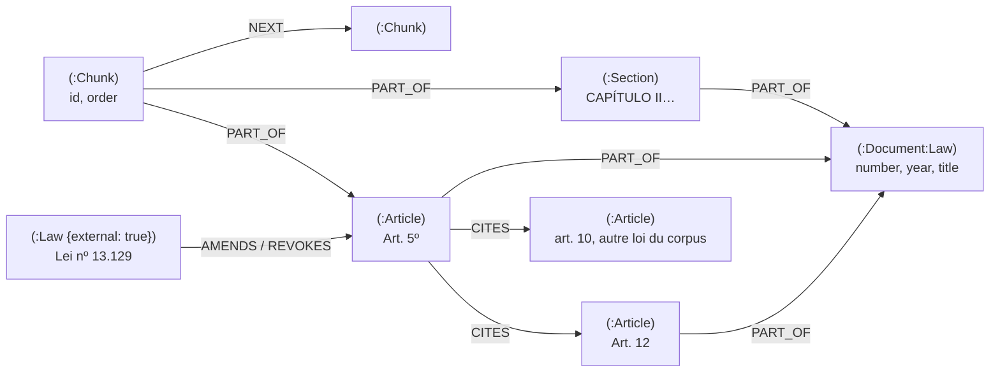

# Graphe des renvois (Neo4j)

Phase 9.9a, mode d'échec « renvois » : dans une loi, la réponse est souvent dans l'article **cité** par celui que la recherche trouve (« as penalidades do art. 12 », « nos termos do art. 5º »). Un RAG classique ne suit pas ces renvois. raglab construit donc, pour chaque index run, un graphe structuré dans Neo4j : les lois, leurs articles et les liens explicites entre eux. La 9.9b s'en servira comme troisième branche de recherche, à côté de la recherche dense et de BM25.

## Ce qui va où

| | PostgreSQL | Neo4j |
|---|---|---|
| documents, chunks, vecteurs, index BM25 | source de vérité | — |
| structure (sections, articles) et relations (renvois, modifications) | — | graphe dérivé, reconstructible |

Le graphe se reconstruit entièrement à partir des chunks d'un index run : on peut l'effacer sans rien perdre. Neo4j Community n'a qu'une base ; chaque nœud porte `index_run_id`, `corpus` et un `uid`, et une reconstruction efface puis réécrit exactement un run. Contraintes d'unicité et index sont créés au premier build.

## Schéma



**Socle commun**, pour tout corpus : `(:Document)`, `(:Section)` quand le texte en a (titres markdown `#`, ou `LIVRO / TÍTULO / CAPÍTULO / SEÇÃO / SUBSEÇÃO` pour les lois), `(:Chunk {id, index_run_id, order})`, `PART_OF` (chunk → section la plus profonde qui contient son début, sinon document ; section → section parente ou document) et `NEXT` (chunk → chunk suivant du même document).

**Profil « lois »** (détecté si au moins la moitié des documents ont des lignes « Art. N », ou forcé par corpus) :

| Élément | Contenu |
|---|---|
| `(:Document:Law)` | une loi du corpus : `number`, `year`, `title`, `ementa` (métadonnées LexML) |
| `(:Law {external: true})` | une loi citée qui n'est pas dans le corpus (« Lei nº 13.129 »), pour garder la trace de qui modifie quoi |
| `(:Article)` | `law_number`, `number` (« 5 », « 4-A »), `label` (« Art. 5º »), `preview`, `revoked`, `vetoed`, bornes dans le texte |
| `(:Chunk)-[:PART_OF {first, overlap}]->(:Article)` | les chunks qui recouvrent l'article (au moins 20 caractères) ; `first` marque celui où commence l'article |
| `(:Article)-[:CITES]->(:Article)` | renvoi vers un article de la même loi ou d'une autre loi du corpus ; `mentions`, `scope` (`same_law`, `cross_law`), `snippet` (la phrase qui porte le renvoi) |
| `(:Article)-[:CITES]->(:Law)` | renvoi vers une loi hors corpus, ou vers un article introuvable dans sa loi ; numéros dans `articles` |
| `(:Law)-[:AMENDS {kind}]->(:Article)` | `rewritten` (« Redação dada pela Lei nº X »), `inserted` (« Incluído pela Lei nº X ») |
| `(:Law)-[:REVOKES {kind}]->(:Article)` | `revoked` (« (Revogado pela Lei nº X) ») |
| `(:Law)-[:AMENDS|REVOKES]->(:Law|:Article)` | dispositifs de la loi elle-même : « A Lei nº X passa a vigorar… », « altera a Lei nº X », « Ficam revogados… » ; `via` = l'article qui le dit |
| `(:GraphRun)` | profil, date, durée et comptes du dernier build de l'index run |

Le profil se choisit par corpus avec `RAGLAB_GRAPH_PROFILES='{"bench_lexml_pt": "laws"}'`, ou par build (`--profile laws|generic|auto`).

## Les règles (sans LLM)

Les renvois juridiques sont explicites dans le texte : une règle les lit mieux et pour moins cher qu'un modèle qui les devinerait. Tout est dans `src/raglab/graph/legal.py`, fonctions pures testées sur des extraits réels (`tests/test_graph_legal.py`).

- **Articles** : une ligne qui commence par « Art. 5º », « Art. 4º-A », « Art 40. » (même règle de début d'article que le résolveur de citations, `article_start_pattern`). Une loi qui en modifie une autre recopie les articles de celle-ci entre guillemets : ces blocs cités sont repérés (ligne qui s'ouvre sur un guillemet, jusqu'au guillemet fermant, ou jusqu'à l'article suivant de la loi elle-même si le guillemet n'est jamais fermé) et leurs « Art. N » ne sont pas pris pour ceux de la loi. Les quelques en-têtes cités sans guillemet sont écartés parce qu'ils cassent la numérotation croissante de la loi (plus longue suite croissante).
- **Renvois** : « art. 12 », « arts. 3º e 4º », « arts. 10 a 15 » (plage développée jusqu'à 10 articles, au-delà seule la borne haute est gardée), « artigo anterior / seguinte ». Le texte qui suit le numéro décide à qui il appartient : « desta Lei » ou rien → cette loi ; « da Lei nº X » → la loi X ; « da Constituição », « do Decreto-Lei », « da Medida Provisória », « do Código »… → pas un article du corpus, ignoré. Les connecteurs (« , § 2º, inciso III, ») sont sautés ; dans « o art. 5º e o § 2º do art. 7º da Lei nº X », l'art. 5 hérite de la loi X. Sans qualificatif, le contexte peut désigner une autre loi : « Decreto-Lei nº 1.940, de 1982, art. 1º », « A Lei nº X passa a vigorar acrescida do seguinte art. 4º-A », un en-tête de liste « II - da Medida Provisória nº … : », « inclusive em seu art. 16 ».
- **Ignoré** : le texte entre guillemets (il appartient à la loi modifiée), les notes éditoriales « (Vide …) », les renvois d'un article à lui-même et ceux vers un numéro absent de la loi.
- **Modifications** : les marqueurs du texte compilé (« Redação dada pela Lei nº X », « Incluído pela… », « (Revogado pela…) ») sont rattachés à l'article qui les contient, avec la portée lue en début de ligne (caput, paragraphe, inciso, alínea) ; un marqueur posé sur un titre de chapitre est ignoré ; les marqueurs « pela Medida Provisória » n'ont pas de loi source et ne sont pas gardés. Les dispositifs de la loi elle-même (« passa a vigorar », « altera a Lei nº », « Ficam revogados : I - … ») donnent des liens loi → loi ou loi → article ; « com a redação dada pela Lei nº Y » ou « alterado pelo art. 13 da Lei nº Y » ne désignent pas Y comme modifiée.

## Construire le graphe

| Où | Comment |
|---|---|
| À l'indexation | automatique quand Neo4j répond (`RAGLAB_GRAPH_BUILD_ON_INDEX=true`, défaut) ; sans Neo4j l'étape est sautée et le résultat le dit (`graph.status = skipped`), l'index reste complet |
| CLI | `raglab graph build --corpus bench_lexml_pt [--index-run ID] [--profile laws]`, `raglab graph status --corpus bench_lexml_pt` |
| API | `POST /api/graph/build` (`corpus` ou `index_run_id`, `profile`) ; `GET /api/graph/status`, `/api/graph/laws`, `/api/graph/neighbourhood` ; 503 si Neo4j ne répond pas |
| UI | Expert → Graphe → **Graphe des renvois** : état du graphe, bouton de construction, liste des lois, voisinage Loi → Articles → renvois (Cytoscape), passage qui porte chaque renvoi |

Neo4j tourne dans Docker Compose (`docker compose up -d neo4j`, Browser sur http://localhost:7474, `neo4j` / `raglab_neo4j`).

## Le voir dans Neo4j Browser

Les articles de la Lei nº 11.445 qui renvoient à un autre article, et leurs cibles :

```cypher
MATCH (l:Law {key: "11445"})<-[:PART_OF]-(a:Article)-[c:CITES]->(b:Article)
WHERE l.index_run_id = $run
RETURN l, a, c, b
```

Les lois du corpus qui se citent entre elles :

```cypher
MATCH (l1:Document:Law)<-[:PART_OF]-(:Article)-[c:CITES {scope: "cross_law"}]->(:Article)-[:PART_OF]->(l2:Law)
WHERE l1.index_run_id = $run
RETURN l1.title, l2.title, count(c) AS renvois ORDER BY renvois DESC
```

Qui a réécrit ou abrogé les articles d'une loi :

```cypher
MATCH (m:Law)-[r:AMENDS|REVOKES]->(a:Article)-[:PART_OF]->(l:Law {key: "7713"})
WHERE l.index_run_id = $run
RETURN m.title, type(r), r.kind, a.label ORDER BY a.order
```

`$run` est l'identifiant de l'index run (`:param run => "63b704a5-…"` dans le Browser) ; la page Graphe affiche la requête prête à coller pour la loi sélectionnée.

## Mesures

Corpus et index runs de `benchmarks/` (index `traditional`), PC de développement, Neo4j 5.20 Community en Docker.

| Corpus | Profil | Nœuds | Relations | Build |
|---|---|---|---|---|
| `bench_lexml_pt` (252 lois) | lois | 252 Document (lois), 526 Section, 6 075 Chunk, 3 984 Article, 603 Law hors corpus | 1 078 CITES article → article (dont 98 entre lois du corpus), 16 CITES → loi du corpus (article introuvable), 775 CITES → loi hors corpus, 1 054 AMENDS, 274 REVOKES, 8 496 PART_OF chunk → article, 5 823 NEXT | 6 s (1,5 s de lecture et d'extraction, 4,5 s d'écriture) |
| `bench_piaf_fr` (761 paragraphes) | générique | 761 Document, 833 Chunk, aucune section (paragraphes Wikipédia sans titre) | 833 PART_OF, 72 NEXT | 0,8 s |

Extraction sur LexML : 4 059 lignes « Art. N », dont 70 dans des blocs cités et 5 hors séquence, soit 3 984 articles ; 2 405 renvois lus (1 137 dans la même loi, 98 vers une autre loi du corpus, 1 170 vers des lois hors corpus) ; 3 215 marques de modification (774 réécritures, 1 119 insertions, 612 abrogations, 533 lois modifiées et 177 abrogations par les dispositifs de la loi elle-même). Les chiffres de l'audit (4 055 débuts d'article, 3 015 renvois) comptaient toutes les mentions « art. N », y compris celles de la Constitution, des décrets et des textes cités entre guillemets.

### Précision de l'extraction

Échantillon tiré au hasard avec une graine parmi les arêtes du graphe, chaque arête vérifiée à la main contre le texte de la loi ; verdicts versionnés dans [`benchmarks/graph/`](../benchmarks/graph/) (`raglab graph sample`, `raglab graph report`).

| Règles | Échantillon | CITES article → article | AMENDS / REVOKES |
|---|---|---|---|
| v1 | graine 42 | 58 / 60 = **0,967** | 26 / 30 = **0,867** |
| v2 (corrections tirées de v1) | graine 43, jamais regardée | 59 / 60 = **0,983** | 27 / 30 = **0,900** |

Les règles v1 ont été figées avant le tirage de la graine 42 (la mise au point s'est faite sur des tirages de développement, graines 7 et 11). Les 6 erreurs trouvées (un décret-loi lu comme une loi, « alterado pelo art. 13 da Lei nº X », « inclusive em seu art. 16 », un en-tête « os seguintes dispositivos da Lei nº X : », un marqueur sur un titre de chapitre, et une note « (Vide artigos 1º e 2º da Mpv …) » repérée dans l'interface) ont donné les règles v2, mesurées sur un nouveau tirage (graine 43). Ce sont les règles v2 qui sont livrées.

### Les questions LexML qui citent un article

Sur les 300 questions du jeu LexML, 100 citent un article (« art. 2 da Lei nº 7.689 »). Les 100 lois sont dans le graphe ; **97 articles** y ont un nœud `Article`, et pour **90** le passage attendu est à l'intérieur de cet article. Les 3 sans nœud citent un article que la loi ne fait que recopier entre guillemets (« art. 11-A da Lei nº 12.704 » est un article de la loi modifiée) : l'étiquette de la question est fausse, le graphe a raison. Les 7 autres ont la réponse dans un article voisin (étiquette imprécise, déjà signalée dans [citations.md](citations.md)).

## Limites

- **Marqueurs isolés** : quand le texte compilé a supprimé un article abrogé, il ne reste qu'une ligne « (Revogado pela Lei nº X) » ; elle est rattachée à l'article qui précède, alors qu'elle peut concerner l'article supprimé (erreur 006 de la graine 43). Même chose pour un marqueur posé sur la ligne de titre d'un chapitre ou d'une section.
- **Connecteurs** : un connecteur absent de la liste (« e em seu § 3º, da Lei nº X ») coupe le qualificatif, et l'article est lu comme un article de la loi elle-même.
- **Décrets, mesures provisoires, Constitution** : leurs articles ne sont pas des nœuds ; seules les lois numérotées (ordinaires et complémentaires) le sont.
- **« Fica revogada a isenção concedida em virtude do art. 30 da Lei nº X »** est lu comme une abrogation de l'art. 30.
- **Pas de vecteurs dans Neo4j** : la recherche vectorielle reste dans PostgreSQL ; le graphe sert à suivre les liens.
- Le store à entités de la phase 8 (chunks avec embeddings et entités extraites par LLM, jamais mesuré) reste disponible derrière `RAGLAB_ENTITY_GRAPH_ENABLED=true` (pages « Indexation / Retrieval (entités) ») ; il partage les étiquettes `Chunk` et `Document` mais jamais leurs nœuds (`uid` ici, `id` là-bas).
