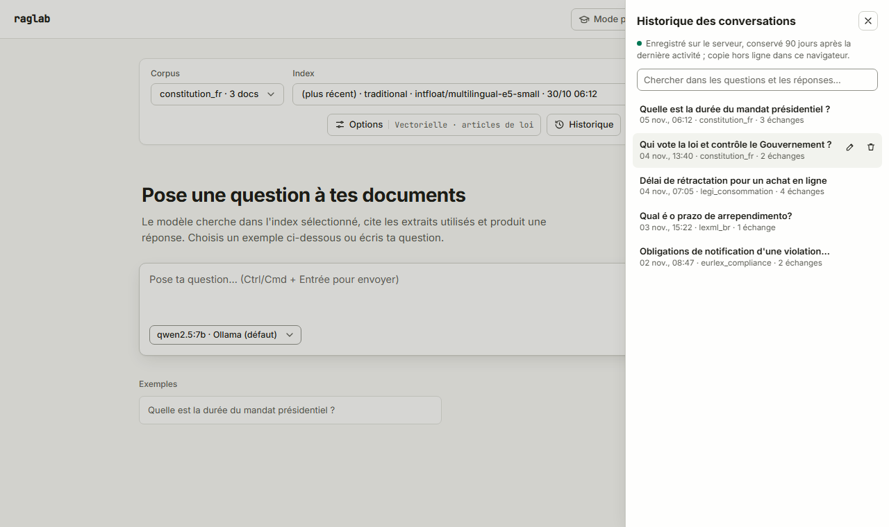
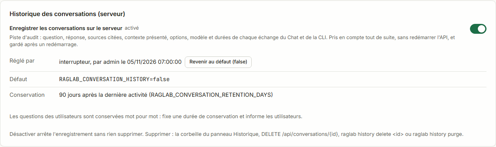
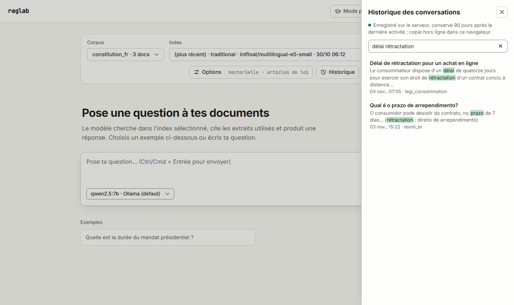
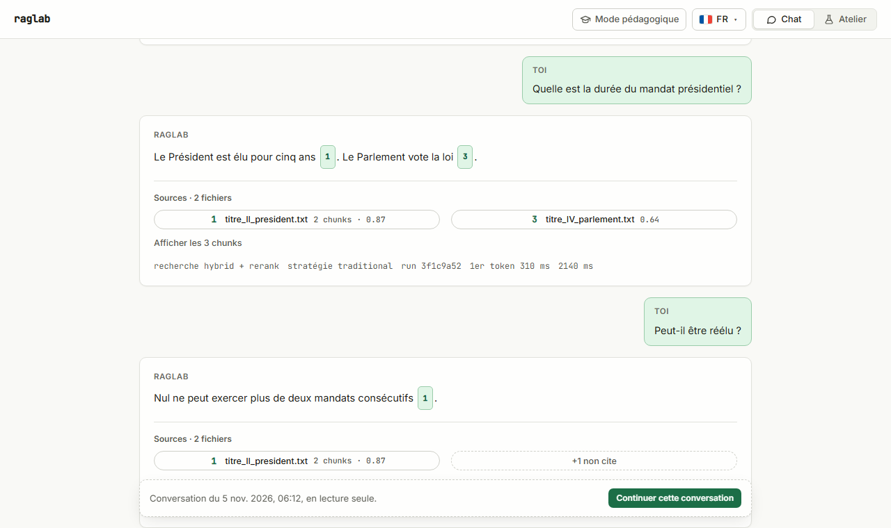

# Historique des conversations

Le Chat garde ses conversations en deux couches :

| Couche | Où | Pour quoi | Actif |
|---|---|---|---|
| **Navigateur** | IndexedDB (`raglab-history`) | usage hors ligne et mono-utilisateur, rechargement de la page | toujours |
| **Serveur** | PostgreSQL (`conversations`, `messages`) | piste d'audit : qui a demandé quoi, avec quelles sources, quel modèle, quelles options | interrupteur de l'Atelier (ou API, CLI) ; défaut `RAGLAB_CONVERSATION_HISTORY` |

Les deux couches partagent **un seul identifiant par conversation et par échange** : il n'y a jamais deux copies d'une même conversation.



## Réglages

| Variable | Défaut | Effet |
|---|---|---|
| `RAGLAB_CONVERSATION_HISTORY` | `false` | valeur par défaut de l'historique serveur (enregistre chaque échange du Chat et de `raglab query --conversation` dans PostgreSQL ; expose `/api/conversations`), tant que personne ne l'a basculé à l'exécution |
| `RAGLAB_CONVERSATION_RETENTION_DAYS` | `0` | supprime les conversations inactives depuis plus de N jours (à chaque échange enregistré et par `raglab history purge`) ; `0` = conservées jusqu'à suppression manuelle |

### Activer ou désactiver sans redémarrer

L'historique serveur se bascule **à l'exécution**, sans toucher aux variables ni redémarrer l'API :

- **Atelier** › **Bases de données** › onglet PostgreSQL, carte « Historique des conversations (serveur) » : interrupteur, état, origine du réglage (défaut de l'installation, ou interrupteur avec qui et quand), valeur de `RAGLAB_CONVERSATION_HISTORY`, durée de conservation, et bouton « Revenir au défaut » ;
- **API** : `GET /api/settings/conversation-history` ; `PUT /api/settings/conversation-history` avec `{"enabled": true}`, `{"enabled": false}` ou `{"enabled": null}` (retour au défaut) ; l'en-tête `X-Raglab-User` est noté comme auteur ;
- **CLI** : `raglab history status`, `raglab history enable`, `raglab history disable`, `raglab history reset`.

La valeur choisie est gardée **en base**, dans la table `runtime_settings` (créée par la même migration `0003_conversations`) : elle survit au redémarrage de l'API, vaut pour tous ses workers et pour la CLI, qui lisent la même base. Un fichier sous `data/` aurait été propre à une machine (l'API en Docker et la CLI sur l'hôte ne le partageraient pas). `/api/config` renvoie la valeur effective, et le Chat bascule tout de suite entre serveur et navigateur.

**Désactiver arrête l'enregistrement, sans rien supprimer** : les conversations déjà stockées restent en base (et redeviennent visibles si on réactive) jusqu'à leur suppression (`raglab history delete`, `raglab history purge`, `DELETE /api/conversations/{id}`) ou leur expiration. Pendant que l'historique est désactivé, `/api/conversations*` répond `404` et le Chat garde l'historique dans le navigateur.



### Pourquoi l'historique serveur est désactivé par défaut

L'historique serveur conserve **ce que les utilisateurs demandent**, mot pour mot, avec les réponses et les passages cités. C'est exactement ce qu'une piste d'audit doit garder, mais c'est aussi un traitement de données qui peuvent être personnelles (une question peut nommer une personne, un dossier, une situation). L'activer est donc une décision explicite de l'exploitant, prise avec sa durée de conservation, et non un effet de bord de l'installation :

- en local, mono-utilisateur, l'historique du navigateur suffit et ne quitte pas le poste ;
- en entreprise, on active l'historique (interrupteur de l'Atelier, ou `RAGLAB_CONVERSATION_HISTORY=true` pour en faire le défaut) **et** on fixe `RAGLAB_CONVERSATION_RETENTION_DAYS` selon la politique de conservation (par exemple 90 ou 365 jours), puis on documente la finalité auprès des utilisateurs.

Le Chat affiche toujours où vit l'historique (bandeau en tête du panneau), y compris la durée de conservation quand elle est fixée.

## Couche navigateur

Chaque conversation est stockée dans IndexedDB avec ses échanges : question, réponse, passages cités (fichier, rang, score, extrait), options de recherche envoyées, corpus, index, fournisseur et modèle, durées, date. Elle survit au rechargement et fonctionne **API arrêtée**.

Chaque accès au stockage est protégé : sans IndexedDB (certaines fenêtres privées, données de site bloquées, quota plein), l'historique vit en mémoire pour la session et le panneau le signale (« l'historique sera perdu au rechargement »). Le Chat fonctionne de la même façon.

### Le panneau Historique

Bouton **Historique** dans la barre du Chat :

- liste des conversations, la plus récente en haut : titre (la première question), date, corpus, nombre d'échanges ;
- **recherche** dans les questions et les réponses, sans tenir compte des accents ni de la casse, extraits surlignés ;
- **rouvrir** une conversation : elle s'affiche en lecture seule (réponses, sources, chunks) avec un bouton **Continuer cette conversation** ;
- **renommer** (crayon, Entrée pour valider, Échap pour annuler) et **supprimer** (corbeille, confirmation).





## Couche serveur

### Schéma (migration `0003_conversations`)

`conversations` : `id` (UUID), `title`, `corpus_name`, `actor` (déclaratif : en-tête `X-Raglab-User`, utilisateur système pour la CLI), `channel` (`ui`, `api`, `cli`), `created_at`, `updated_at`.

`messages` (supprimés avec leur conversation, `ON DELETE CASCADE`), un par échange :

| Colonne | Contenu |
|---|---|
| `position`, `question`, `answer` | l'échange, dans l'ordre |
| `status`, `error` | `completed`, `stopped` (client parti pendant la réponse, réponse partielle gardée) ou `failed` (avec le message d'erreur) |
| `retrieved_json` | passages retrouvés : `chunk_id`, `document_id`, `file_name`, `source_path`, `char_start`, `char_end`, `rank`, `score`, `cited` (la réponse cite `[Rank N]`) |
| `presented_context` | le contexte du rédacteur **tel qu'il l'a lu** (`generation.prompts.presented_passages` : ligne de version, dispositions abrogées remplacées) ; vide si rien n'a été généré ou si le routeur s'est abstenu |
| `citation_json`, `routing_json` | citation juridique reconnue et son statut ; décisions du routeur |
| `options_json` | options résolues contre les défauts du serveur (`top_k`, mode, poids, `rrf_k`, re-ranking, citations, graphe, versions, traduction, dédoublonnage, routage, filtres) et ce que le pipeline a réellement fait |
| `llm_provider`, `llm_model`, `generator_notice` | qui a rédigé la réponse, et pourquoi le repli a répondu le cas échéant |
| `timings_ms`, `elapsed_ms`, `first_token_ms` | durées par étape |
| `request_id` | identifiant de corrélation (`X-Request-ID`), pour retrouver les logs |
| `ts_config`, `search_tsv` | index plein texte (voir ci-dessous) |

`corpus_name` et `index_run_id` sont des valeurs, pas des clés étrangères : supprimer un corpus ou un index ne réécrit pas ce qui a été demandé et répondu.

### Recherche plein texte

Même principe que le BM25 ([retrieval-hybrid.md](retrieval-hybrid.md)) : chaque message reçoit un `tsvector` de sa question et de sa réponse, construit avec la configuration de **sa langue** (`raglab_french`, `raglab_portuguese`, sinon `raglab_simple`), qui ôte les accents avant la racinisation. La langue vient du routeur quand il a tourné, sinon de la question. Une recherche combine (OU) la requête analysée par chaque configuration : une recherche en français trouve les échanges en français par racinisation française, sans qu'on nomme la langue. Syntaxe « moteur de recherche » de PostgreSQL : mots (tous requis), `"phrase exacte"`, `-exclu`, `or`. Index GIN sur `search_tsv`.

Exemples mesurés dans les tests : `durees` trouve « durée », `presidents elue` trouve « Président est élu », `arrependimentos` trouve « arrependimento ».

### API

| Méthode | Route | Effet |
|---|---|---|
| `GET` | `/api/conversations?corpus=&since=&until=&limit=&offset=` | liste, la plus récemment active d'abord ; filtre par corpus et par dates (`AAAA-MM-JJ`) |
| `GET` | `/api/conversations/search?q=&corpus=&since=&until=&limit=` | recherche plein texte, meilleur résultat d'abord, extrait avec correspondances entre `⟦` et `⟧` |
| `GET` | `/api/conversations/{id}` | conversation complète avec ses messages |
| `POST` | `/api/conversations` | crée une conversation (`{id?, title?, corpus?, channel?}`) ; un `id` proposé par le client est gardé, et le recréer renvoie l'existante |
| `PATCH` | `/api/conversations/{id}` | renomme (`{title}`) |
| `DELETE` | `/api/conversations/{id}` | supprime la conversation et ses messages (définitif, pas de corbeille) |
| `GET` / `PUT` | `/api/settings/conversation-history` | état de l'historique serveur et bascule à l'exécution (voir plus haut) ; répond aussi quand l'historique est désactivé |

`POST /api/query` et `POST /api/query/stream` acceptent deux champs optionnels : `conversation_id` (l'échange est ajouté à cette conversation) et `message_id` (UUID de l'échange choisi par le client, pour que sa copie locale et la ligne serveur partagent l'identifiant). La réponse (ou l'événement SSE `done`) porte en retour `conversation_id` et `message_id`, `null` quand l'échange n'a pas été enregistré. Sans `conversation_id`, rien ne change : `POST /api/query` reste compatible.

Historique désactivé : `/api/conversations*` répond `404` (`ConversationHistoryDisabledError`) et un `conversation_id` envoyé à `/api/query` est ignoré (réponse `conversation_id: null`), pour que le Chat continue de fonctionner. Conversation inconnue : `404` (`ConversationNotFoundError`). Un échec d'écriture de l'historique est journalisé (`conversation.record_failed`) mais ne fait pas échouer la réponse.

### CLI

```bash
raglab query "Quelle est la durée du mandat ?" --corpus constitution --conversation new
raglab query "Et celui des sénateurs ?" --corpus constitution --conversation <id>
raglab history list [--corpus X] [--since 2026-11-01] [--until 2026-11-30] [--json]
raglab history show <id> [--json]
raglab history search "mandat president" [--corpus X] [--json]
raglab history delete <id> [--yes]
raglab history purge [--older-than-days 90] [--yes]
raglab history status | enable | disable | reset
```

`--conversation new` ouvre une conversation (canal `cli`, acteur = utilisateur système) et affiche son `conversation_id` dans le JSON. Historique désactivé : ces commandes sortent en erreur avec un message explicite (sauf `status`, `enable`, `disable`, `reset`).

## Synchronisation des deux couches

| Situation | Comportement du Chat |
|---|---|
| Historique serveur actif, API joignable | la première question crée la conversation sur le serveur (`POST /api/conversations`), qui donne son id ; chaque échange est envoyé avec `conversation_id` et `message_id` ; la liste, la recherche, le renommage et la suppression passent par le serveur ; IndexedDB garde une copie hors ligne |
| Historique serveur désactivé (par défaut ou depuis l'Atelier) | IndexedDB seul ; le panneau l'indique ; une bascule dans l'Atelier s'applique au Chat sans recharger la page |
| API injoignable | IndexedDB seul « en attendant » ; le panneau l'indique et propose de réessayer |
| Conversation commencée hors ligne, continuée serveur revenu | adoptée par le serveur sous **son propre id** (`POST /api/conversations` avec `id`) ; les échanges posés hors ligne restent dans le navigateur, les suivants sont enregistrés |
| Conversation supprimée ailleurs (CLI, autre navigateur) | sa copie locale disparaît à la prochaine ouverture du panneau |

Une suppression faite API injoignable n'efface que la copie locale : la conversation réapparaît depuis le serveur à son retour.

## Conservation et suppression

- **Durée** : `RAGLAB_CONVERSATION_RETENTION_DAYS` supprime les conversations inactives (dernier échange) depuis plus de N jours, à chaque échange enregistré ; `raglab history purge` l'applique à la demande (par exemple depuis une tâche planifiée), `--older-than-days` fixe une autre limite.
- **Suppression** : `DELETE /api/conversations/{id}`, `raglab history delete <id>` ou la corbeille du panneau suppriment la conversation et tous ses messages, définitivement.
- **Navigateur** : la copie locale se supprime depuis le panneau ; effacer les données du site dans le navigateur la supprime aussi.
- **Ce qui n'est pas dans l'historique** : un appel API sans `conversation_id` n'est pas enregistré (seul l'événement `query.completed` est journalisé, sans le texte de la question), pas plus que les benchmarks.

## Tests

- unitaires : `tests/test_conversation_record.py` (ce qu'un échange enregistre), `tests/api/test_api_conversations.py` (historique désactivé, conversation inconnue, identifiants renvoyés) ;
- intégration PostgreSQL : `tests/test_conversations_postgres.py` (interrupteur à l'exécution par l'API et la CLI, désactivation sans suppression, positions, ids proposés par le client, recherche par langue et sans accents, filtres, renommage, suppression en cascade, conservation, API de bout en bout avec le flux SSE, CLI), sur une base `*_test` via `RAGLAB_TEST_DATABASE_URL` ;
- bout en bout : `frontend/e2e/history.spec.ts` (navigateur seul avec rechargement, recherche, réouverture, reprise, renommage, suppression ; historique serveur avec un id unique ; API arrêtée) et `frontend/e2e/history-setting.spec.ts` (interrupteur de l'Atelier : activé, désactivé, état après rechargement, retour au défaut, effet sur le Chat).
