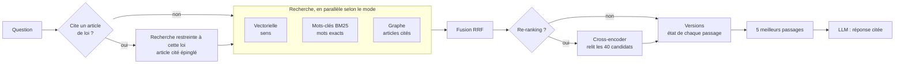

# Modes de recherche et options

Ce que fait raglab entre la question et la réponse, chaque option, sa valeur par défaut, et ce que chacune a apporté sur les benchmarks figés. Le détail de chaque brique est dans sa page : [retrieval-hybrid.md](retrieval-hybrid.md), [reranking.md](reranking.md), [citations.md](citations.md), [graphe.md](graphe.md), [versions.md](versions.md).

## Le chemin d'une question

1. **Références d'articles** (corpus de lois seulement) : si la question cite « art. 49 da Lei 8.078 » ou « article L. 221-18 du Code de la consommation », la recherche est limitée à ce texte et l'article cité passe en tête, avant et après le re-ranking. Sans citation, l'étape ne fait rien.
2. **Recherche**, selon le mode :
   - **vectorielle** (`dense`) : compare le sens de la question à celui des passages (embeddings `multilingual-e5-small`, recherche exacte dans pgvector) ; bonne sur les reformulations ;
   - **mots-clés** (`lexical`) : BM25 calculé dans PostgreSQL ; bonne sur les noms propres, les sigles, les numéros ;
   - **hybride** (`hybrid`, défaut) : les deux **en parallèle**, puis fusion RRF : un passage bien classé par l'une ou l'autre remonte ;
   - **graphe** (option `graph`, en plus du mode) : suit dans Neo4j les renvois des meilleurs passages (« nos termos do art. 12 ») et ajoute les articles cités à la fusion ; il n'ajoute que des passages que les deux autres ont manqués.
3. **Fusion RRF** : chaque passage reçoit `Σ poids / (k + rang)` sur les listes où il apparaît ; `k = 60`, poids BM25 `0,5`, poids graphe `0,5`.
4. **Re-ranking** : un cross-encoder (`bge-reranker-v2-m3`) relit chaque candidat avec la question et réordonne les 40 premiers. Plus précis que la fusion, mais environ 0,5 s par question sur un GPU portable. Sans GPU, il est **désactivé par défaut** (il prendrait plusieurs secondes sur CPU) ; une demande explicite le lance quand même sur CPU.
5. **Versions** (corpus de lois seulement, `versions=in_force` par défaut) : la recherche ne voit que les versions d'articles en vigueur à la date de référence, aujourd'hui ou celle que demande la question (« avant 2016 ») ; sur le Code de la consommation, les autres versions sont écartées dans la requête SQL, avant le classement ; sur les lois compilées de LexML, un passage dont toutes les dispositions sont « (Revogado) » passe en fin de liste et les dispositions abrogées sont masquées au modèle. Chaque passage porte son état (en vigueur depuis, ancienne version, abrogé), que le prompt donne au modèle. Voir [versions.md](versions.md).
6. **Génération** : les 5 premiers passages sont donnés au LLM, qui répond en citant ses sources (`[Rank N]`) ou dit que l'information n'est pas dans les documents.

## Les options

| Option | Valeurs | Défaut | CLI | API (`/api/query`) | Variable |
|---|---|---|---|---|---|
| Mode de recherche | `dense`, `lexical`, `hybrid` | `hybrid` | `--retrieval-mode` | `retrieval_mode` | `RAGLAB_DEFAULT_RETRIEVAL_MODE` |
| Poids BM25 dans la fusion | 0 à 1 | 0,5 | `--lexical-weight` | `lexical_weight` | `RAGLAB_HYBRID_LEXICAL_WEIGHT` |
| Constante RRF `k` | entier | 60 | `--rrf-k` | `rrf_k` | `RAGLAB_RRF_K` |
| Re-ranking | oui / non | oui avec GPU, non sans | `--rerank/--no-rerank` | `rerank` | `RAGLAB_DEFAULT_RERANK`, `RAGLAB_RERANK_WITHOUT_GPU` |
| Candidats relus par le re-ranking | entier | 40 | — | — | `RAGLAB_RERANK_CANDIDATES` (20 = option rapide) |
| Références d'articles | oui / non | oui | `--citations/--no-citations` | `citations` | `RAGLAB_CITATION_RESOLVER` |
| Recherche par graphe | oui / non | **non** (en cours de mesure) | `--graph/--no-graph` | `graph` | `RAGLAB_GRAPH_RETRIEVAL`, `RAGLAB_GRAPH_WEIGHT` |
| Versions des articles | `in_force`, `all`, `as_of=AAAA-MM-JJ` | `in_force` | `--versions` | `versions` | `RAGLAB_VERSIONS_DEFAULT` |
| Passages donnés au LLM | entier | 5 | `--top-k` | `top_k` | `RAGLAB_DEFAULT_TOP_K` |
| Fournisseur du LLM | `ollama`, `llamacpp`, `vllm` | `ollama` | `--provider` | `llm_provider` (+ `llm_model`) | `RAGLAB_LLM_PROVIDERS`, `RAGLAB_DEFAULT_LLM_PROVIDER` |

Dans l'interface, ces options sont dans « Options » du Chat et sur la page Interrogation de l'Atelier, qui affiche en plus le score de chaque passage à chaque étape : vectoriel, BM25, fusion, graphe, re-ranking.

## Ce que chaque option a apporté

Mesures appariées sur les jeux figés (PIAF : 500 questions en français ; LexML : 277 questions sur 252 lois brésiliennes). Détail et intervalles de confiance dans les pages de chaque brique.

| Configuration | PIAF Recall@5 | LexML Recall@5 | Questions citant un article | Recherche p50 |
|---|---|---|---|---|
| Vectorielle seule (`baseline-v1`) | 0,878 | 0,466 | 9 % | 23 ms |
| Mots-clés seuls (`lexical-v1`) | 0,838 | 0,477 | 6 % | 7 ms |
| Hybride (`hybrid-v1`) | 0,900 | 0,498 | 9 % | 43 ms |
| Hybride + re-ranking (`rerank-v1`) | 0,966 | 0,596 | 9 % | 461 ms |
| Vectorielle + références d'articles (`citations-v1`) | 0,878 | 0,697 | 75 % | 26 ms |
| **Hybride + re-ranking + références (`full-v1`, défaut)** | **0,966** | **0,816** | **72 %** | 537 à 635 ms |
| + graphe | à mesurer | à mesurer | à mesurer | à mesurer |
| + versions (`versions-v1`, `in_force`, défaut) | 0,966 | 0,816 | 72 % | recherche PIAF 32 → 53 ms, LexML 77 → 97 ms ; Code de la consommation 80 → 320 ms |

## Quel réglage choisir

- **Par défaut** (hybride, re-ranking, références) : la meilleure qualité mesurée.
- **Le plus rapide** : `--retrieval-mode dense --no-rerank`, environ 25 ms de recherche au lieu d'environ 0,5 s, au prix d'environ 9 points de Recall@5 sur PIAF et de 12 sur LexML (`citations-v1` contre `full-v1`).
- **Sans GPU** : le re-ranking est désactivé de lui-même ; tout le reste fonctionne.
- **Corpus sans lois** (documentation, Wikipédia) : les options références d'articles, graphe et versions sont masquées dans l'interface et sans effet.
- **Corpus versionné** (Code de la consommation) : le défaut `in_force` écarte les versions abrogées ou remplacées : Recall@5 0,660 → 0,820 sur 300 questions, 0,750 → 0,930 sur le jeu « versions », version périmée classée au-dessus de la bonne 57 % → 0 % (voir [versions.md](versions.md)) ; `--versions all` les garde toutes, comme un RAG classique.
