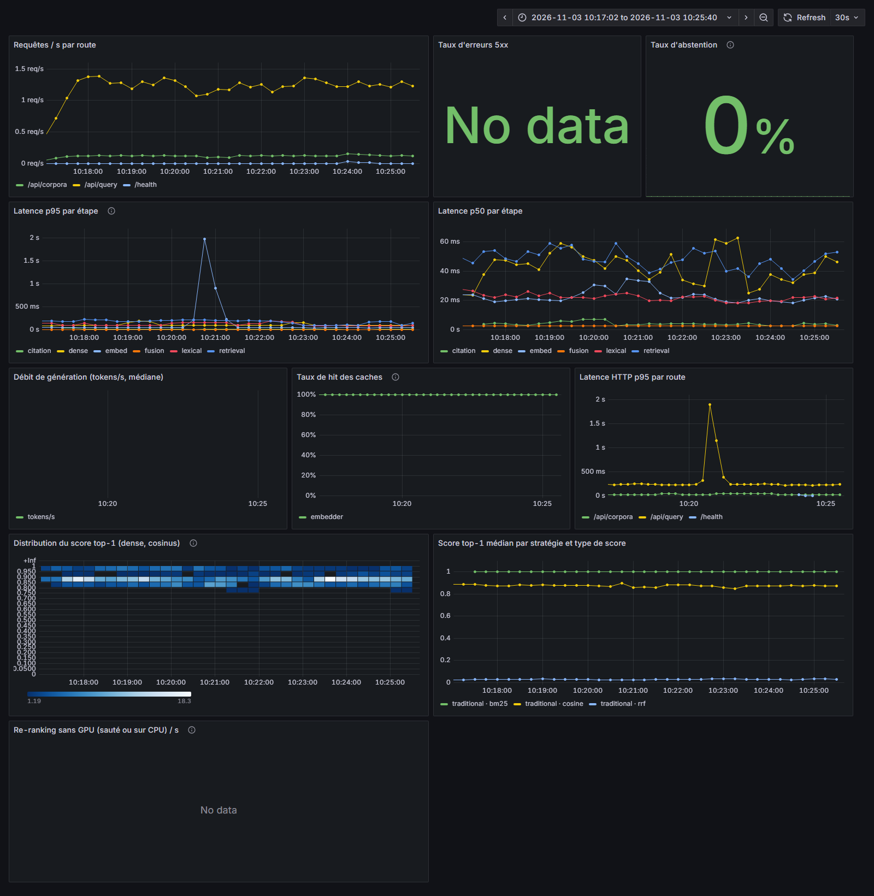

# Observabilité (phase 9.6)

Trois briques :

1. `GET /metrics` : métriques Prometheus de l'API et du pipeline de requête ;
2. un profil Docker Compose `obs` (Prometheus + Grafana, tableau de bord versionné) ;
3. un rapport de dérive `raglab experiment drift` (et `POST /api/experiments/drift`)
   qui compare deux ensembles de résultats d'expérience.

Rien de tout ça ne touche au GPU ni au schéma de la base.

## `/metrics`

Format texte Prometheus (`prometheus_client`). Le point d'entrée est public
(comme `/health` et `/ready`) : il n'exige pas la clé d'API et n'est pas
soumis à la limite de débit. `RAGLAB_METRICS_ENABLED=false` retire la route
et le middleware de comptage.

| Métrique | Type | Labels | Contenu |
|---|---|---|---|
| `raglab_http_requests_total` | compteur | `route`, `method`, `status` | requêtes HTTP ; `route` est le gabarit (`/api/experiments/{run_id}`), `unmatched` si aucune route ne correspond (404, 401/429 renvoyés par le middleware) |
| `raglab_http_request_duration_seconds` | histogramme | `route`, `method` | durée jusqu'au dernier octet, flux SSE compris |
| `raglab_stage_duration_seconds` | histogramme | `stage` | une observation par clé de `timings_ms` : `embed`, `retrieval` (recherche complète, citation comprise), `citation`, puis en mode lexical ou hybride `dense`, `lexical`, `fusion`, enfin `rerank` et `generation` |
| `raglab_queries_total` | compteur | `strategy`, `generated` | requêtes terminées (dénominateur du taux d'abstention) |
| `raglab_retrieval_top1_score` | histogramme | `strategy`, `score_type` (`cosine`, `bm25`, `rrf`, `rerank`) | score du premier chunk (seaux de 0,05 entre 0 et 1) ; les échelles diffèrent selon le classement final : cosinus en mode dense, RRF (~0,01 à 0,03) en hybride, score du cross-encoder avec re-ranking, BM25 non borné (souvent dans `+Inf`) en lexical |
| `raglab_generation_tokens_per_second` | histogramme | — | débit rapporté par Ollama (`eval_count / eval_duration`) |
| `raglab_cache_lookups_total` | compteur | `cache` (`embedder`, `reranker`), `result` (`hit`, `miss`) | consultations de cache |
| `raglab_rerank_notices_total` | compteur | `notice` (`skipped_no_gpu`, `cpu`) | requêtes dont le re-ranking n'a pas trouvé de GPU : sauté (re-ranking par défaut) ou exécuté sur CPU (demande explicite), comme `rerank_notice` dans la réponse |
| `raglab_abstentions_total` | compteur | `reason` | refus de répondre du routeur (9.4) |

Plus les métriques de processus fournies par `prometheus_client`
(`process_cpu_seconds_total`, `process_resident_memory_bytes`…).

Les labels restent à faible cardinalité : jamais de chemin brut, d'identifiant,
de question ni de modèle choisi par l'appelant. Un nom d'étape ou de raison
d'abstention qui ne respecte pas `^[a-z][a-z0-9_]{0,31}$` est ignoré
(étape) ou ramené à `other` (raison).

### Brancher les briques suivantes

Le module `raglab.observability.metrics` expose des fonctions plutôt que les
objets Prometheus :

```python
from raglab.observability.metrics import record_abstention

record_abstention("low_score")  # routeur 9.4, raisons en nombre fini
```

Les durées d'étape n'ont besoin d'aucun appel : `QueryService` transmet tout
`timings_ms` à `observe_query` à la fin de chaque requête (`/api/query`,
`/api/query/stream`, CLI, benchmarks). Toute nouvelle clé de `timings_ms`
apparaît donc toute seule dans Grafana. `observe_query` reçoit aussi
`rerank_stats` (le cache de scores du cross-encoder compte un *hit* ou un
*miss* par candidat) et `rerank_notice`.

Le cache `embedder` compte aujourd'hui la réutilisation du modèle d'embedding
résident (`build_embedding_provider`) : un *miss* veut dire chargement du
modèle.

### Limites

- Compteurs par processus : avec plusieurs workers uvicorn chacun a les siens
  (pas de mode multiprocess). La configuration Compose lance un seul worker.
- Les métriques des commandes CLI (benchmarks) vivent le temps du processus
  et ne sont pas exposées ; seules celles de l'API sont collectées.

## Profil Compose `obs`

```bash
docker compose --profile obs up -d
```

| Service | Image | Adresse |
|---|---|---|
| Prometheus | `prom/prometheus:v3.5.0` | http://127.0.0.1:9090 |
| Grafana | `grafana/grafana:12.1.1` | http://127.0.0.1:3000 |

- Ports liés à `127.0.0.1` uniquement.
- Prometheus collecte `/metrics` toutes les 15 s sur deux cibles : le service
  `api` (profil `app`) et `host.docker.internal:8000` (API lancée sur l'hôte
  avec uvicorn). Une seule des deux est active ; l'autre apparaît *down* dans
  Prometheus, c'est attendu. Rétention 15 jours (volume `raglab_prometheus_data`).
- Grafana : source de données et tableau de bord provisionnés depuis
  [`observability/grafana/`](../observability/grafana/) ; accès anonyme en lecture
  seule (rôle *Viewer*), inscription fermée. Le compte `admin` garde son mot de
  passe (`RAGLAB_GRAFANA_ADMIN_PASSWORD`, `raglab` par défaut).
- Le tableau de bord ([`raglab.json`](../observability/grafana/dashboards/raglab.json))
  est versionné et non modifiable depuis l'interface : on le change dans le dépôt.

Panneaux : requêtes/s par route, taux de 5xx, taux d'abstention, latence p50 et
p95 par étape, débit de génération, taux de hit des caches, latence HTTP p95
par route, carte de chaleur du score top-1 cosinus (mode dense), score top-1 médian par stratégie et type de score, et
re-ranking sans GPU (sauté ou sur CPU).



*Capture prise sur une API lancée sur l'hôte : environ 640 requêtes de
recherche en 9 minutes, sans génération ni re-ranking (`bench_piaf_fr` et
`bench_lexml_pt`, modes dense, lexical et hybride, résolveur de citations
actif), plus quelques requêtes en 400 sur un corpus inconnu. Les panneaux
débit de génération et re-ranking sans GPU restent vides faute de génération
et de re-ranking ; la médiane BM25 plafonne à 1 parce que ses scores tombent
dans le seau `+Inf`.*

Vérifié en local (sans GPU) : `promtool check config` valide, cible
`host.docker.internal:8000` *up*, tableau de bord provisionné et lisible sans
connexion, chaque requête PromQL du tableau acceptée par Prometheus.

## Rapport de dérive

Compare deux ensembles de lignes `experiment_results`. Chaque ensemble est
sélectionné par index run, experiment run et/ou fenêtre de dates sur
`created_at` (les critères se combinent en ET) :

```bash
# deux index (ré-indexation, autre modèle d'embedding…)
raglab experiment drift --baseline-index-run <id> --candidate-index-run <id>

# deux fenêtres de temps, sortie JSON, code de sortie 1 en cas de dérive
raglab experiment drift \
  --baseline-since 2026-10-01 --baseline-until 2026-10-15 \
  --candidate-since 2026-10-15 --candidate-until 2026-11-01 \
  --format json --output reports/drift.json --fail-on-drift
```

API : `POST /api/experiments/drift` avec
`{"baseline": {"index_run_id": "…"}, "candidate": {"since": "2026-10-15T00:00:00Z"}}`
(champs `index_run_id`, `experiment_run_id`, `since`, `until`, plus `alpha`,
`mean_threshold`, `min_samples`). La réponse contient le rapport JSON et sa
version Markdown (`markdown`).

### Ce qui est comparé

| Contrôle | Données | Test | Signalé si |
|---|---|---|---|
| Score top-1 | `retrieved_scores[0]` | Kolmogorov-Smirnov à deux échantillons | p < `alpha` (0,05) |
| Score moyen top-k | moyenne de `retrieved_scores` | KS | p < `alpha` |
| Rang réciproque | `reciprocal_rank` / `retrieval_reciprocal_rank` | KS | p < `alpha` |
| Juges RAGAS | `faithfulness`, `answer_relevancy`, `answer_correctness` | écart de moyennes | baisse ≥ `mean_threshold` (0,05) |
| MRR, recall@5, recall@10 | métriques par cas | écart de moyennes | baisse ≥ `mean_threshold` |

Le test KS n'est fait qu'à partir de `min_samples` (10) valeurs de chaque
côté ; en dessous la ligne est marquée « échantillon insuffisant ». Le rapport
donne aussi les quantiles p10/p25/p50/p75/p90 des deux distributions et l'écart
de médiane. Une hausse n'est jamais signalée comme régression.

La p-value est l'approximation asymptotique de la loi de Kolmogorov (avec la
correction de Stephens), implémentée en numpy pour ne pas ajouter scipy :
statistique identique à `scipy.stats.ks_2samp`, p-value à ±0,015 de
`method="asymp"` sur les cas testés (n ≥ 30).

### Données disponibles

Les scores de retrieval sont enregistrés dans `metrics_json.retrieved_scores`
depuis cette phase (`raglab experiment recall` et `raglab experiment run`), sans
migration (colonne JSONB existante). Les résultats plus anciens n'alimentent
que les contrôles de rang et de RAGAS ; les contrôles de score affichent
« échantillon insuffisant ». Pour une première comparaison de scores, il faut
donc rejouer un benchmark de référence.

### Preuve

`tests/test_drift.py` plante une régression : 200 cas de référence (score
top-1 ~ N(0,82 ; 0,04), fidélité 85 %) contre 200 cas dégradés (score top-1
~ N(0,76 ; 0,04), fidélité 65 %). Le rapport signale `top1_score`,
`mean_topk_score` et `faithfulness` (p < 1e-6, écart de médiane ≈ −0,06).
Deux tirages de la même distribution ne déclenchent rien, et une amélioration
n'est pas une régression.

## Coût de l'instrumentation

`scripts/bench_observability.py` appelle l'application ASGI directement
(sans client HTTP), variantes entrelacées sur 5 tours. « avec » = middleware
de métriques + `observe_query` ; « sans » = les deux retirés. Le pipeline de
`/api/query` est simulé par une attente active de 60 ms (ordre de grandeur
d'une requête sans génération dans la baseline 9.1).

| route | variante | requêtes | médiane (µs) | p95 (µs) | écart médiane |
|---|---|---:|---:|---:|---:|
| GET /api/bench-ping (triviale) | sans | 5000 | 71 | 95 | |
| GET /api/bench-ping (triviale) | avec | 5000 | 82 | 104 | +11 µs |
| POST /api/query (pipeline simulé 60 ms) | sans | 300 | 62 398 | 63 444 | |
| POST /api/query (pipeline simulé 60 ms) | avec | 300 | 62 502 | 63 329 | +105 µs (+0,17 %) |

Objectif < 1 % tenu : environ 0,1 ms par requête, à comparer à des requêtes
de 60 ms sans génération et de plusieurs secondes avec. Mesuré sur la machine
de dev (Windows, CPU), pendant qu'un autre benchmark tournait : l'écart de
médiane sur `/api/query` est du même ordre que le bruit de mesure.

```bash
PYTHONPATH=src python scripts/bench_observability.py --requests 300
```
