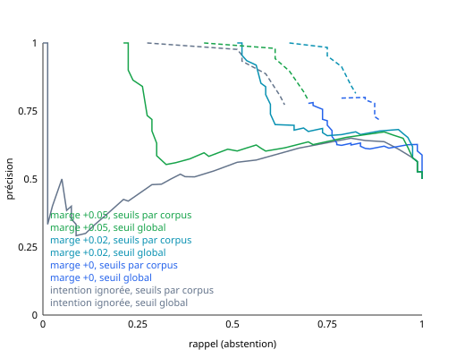

# Routeur de requêtes et abstention (phase 9.4)

Le routeur s'exécute avant le retrieval. Il détecte la langue de la question, devine son intention, choisit le corpus quand plusieurs sont indexés, puis, une fois les passages récupérés, décide s'il faut **s'abstenir** plutôt que générer une réponse sans appui. Il n'appelle aucun LLM : un embedding de la question (multilingual-e5-small, déjà chargé pour le retrieval), quelques produits scalaires et des listes de mots. Chaque décision est renvoyée avec les scores qui l'ont produite.

Il est **désactivé par défaut** : rien ne change tant qu'une requête ne demande pas `routing`.

## Activer le routage

| Où | Comment |
|---|---|
| CLI | `raglab query "Quelle est la capitale de la Mongolie ?" --routing` (sans `--corpus`, le routeur choisit le corpus) ; marche aussi avec `--stream` |
| API | `"routing": true` dans le corps de `POST /api/query` ou `POST /api/query/stream` ; `corpus` et `index_run_id` deviennent facultatifs. La réponse porte un champ `routing` (absent ou `null` sinon) |
| Interface | Chat : case « Routage » dans la barre de réglages, et corpus « Automatique (routeur) ». Retrieval (mode expert) : case « Routage » et panneau détaillé avec tous les scores |

Quand le routeur décline, la réponse vient de lui et le LLM n'est pas appelé :

- question hors périmètre ou passages trop faibles : « Je ne trouve pas cela dans les documents. » (fr) / « Não encontrei isso nos documentos. » (pt) ;
- conversation (salutations, remerciements, questions sur l'assistant) : une phrase qui rappelle que l'assistant répond sur les documents indexés.

Les passages récupérés restent dans la réponse de l'API (transparence), mais le Chat ne les affiche pas comme sources quand le routeur a décliné.

## Ce que fait le routeur

**Langue (fr / pt / autre).** On compte les mots-outils propres à chaque langue (« le », « est », « quel » contre « o », « é », « qual »…) et les lettres qu'une seule des deux écrit (è, œ contre ã, õ, á, « -ção »). Les mots communs aux deux (« de », « que », « a ») sont exclus. Quelques mots anglais servent seulement à répondre « autre ». Quand la question ne contient aucun indice (« Beleza. »), la langue de l'exemple étiqueté le plus proche décide (`method: embedding`).

**Intention.** Trois petits jeux d'exemples écrits pour le routeur (`src/raglab/routing/examples.py`, 15 à 16 phrases par intention et par langue) : `documentary` (questions dont la réponse est dans un texte), `conversational`, `out_of_scope` (données personnelles, temps réel, tâches à exécuter, affaires internes). On calcule un centroïde par intention et par langue ; le score d'une intention est la similarité cosinus au plus proche de ses centroïdes. `documentary` l'emporte sauf si une autre intention le dépasse de plus de `RAGLAB_ROUTING_INTENT_MARGIN` : refuser à tort coûte plus cher qu'un retrieval inutile, que l'abstention par score peut encore rattraper. Aucun de ces exemples ne vient des jeux d'évaluation (un test le vérifie).

**Corpus.** Pour chaque corpus, on prend le dernier index_run pgvector terminé dans le même espace d'embedding que le routeur, et la moyenne de ses embeddings de chunks (un `AVG` en SQL, calculé une fois par index_run puis gardé en mémoire). Le corpus le plus proche de la question gagne ; la marge avec le second est renvoyée. Si l'appelant nomme un corpus ou un index_run, ce choix est respecté et le routeur indique seulement le corpus qu'il aurait choisi.

**Abstention.** Après le retrieval, le routeur s'abstient si l'intention n'est pas documentaire, si aucun passage n'est revenu, ou si le meilleur score est sous le seuil **du corpus interrogé**. Le score vient de `RAGLAB_ROUTING_SCORE_SOURCE` : `dense` (similarité cosinus, `dense_score` en mode hybride 9.2) ; `rerank` lit le score du cross-encoder de la phase 9.3 (`rerank_score`). En mode hybride, un passage trouvé seulement par BM25 (ou épinglé par le résolveur de citations) n'a pas de similarité cosinus et n'entre pas dans le score `dense`.

**Citations juridiques.** Une question qui cite une loi (« art. 49 da Lei nº 8.078 ») n'est jamais refusée, quels que soient l'intention et le score : elle désigne un document, et ses passages viennent du résolveur de citations plutôt que de la similarité (les identifiants s'encodent mal, le score dense y est justement faible). La décision porte alors `abstention.override = "legal_citation"` et `legal_citation` contient la citation reconnue. L'évaluation hors ligne applique la même règle.

**Pipeline derrière le routeur.** Le routeur décide la langue, l'intention et le corpus avant le retrieval ; quand il répond, le retrieval suit les réglages par défaut (hybride BM25 + RRF, re-ranking cross-encoder, résolveur de citations) ou ceux de la requête.

Pourquoi un seuil par corpus : les scores denses n'ont pas la même échelle d'un corpus à l'autre. Sur nos index, une question LexML qui a sa réponse obtient au moins 0,87, une question PIAF parfois 0,74 : aucun seuil global ne sépare bien les deux. Les seuils par corpus sont calibrés sur des questions in-scope **disjointes** de celles qu'on évalue (voir plus bas).

**Une seule passe d'embedding.** Quand le routeur choisit le corpus, le retrieval réutilise le vecteur de la question au lieu de le recalculer. Le temps d'embedding apparaît alors dans `timings_ms.routing`, et `timings_ms.embed` est proche de zéro.

## Réglages

| Variable | Défaut | Rôle |
|---|---|---|
| `RAGLAB_ROUTING_INTENT_MARGIN` | `0.02` | avance qu'une intention non documentaire doit avoir sur `documentary` |
| `RAGLAB_ROUTING_ABSTENTION_THRESHOLDS` | `{"bench_piaf_fr": 0.7341, "bench_lexml_pt": 0.8666}` | seuils par corpus, en JSON (défaut : point A, voir plus bas) |
| `RAGLAB_ROUTING_ABSTENTION_THRESHOLD` | `0.0` | seuil des corpus sans seuil propre (0 = pas d'abstention par score) |
| `RAGLAB_ROUTING_SCORE_SOURCE` | `dense` | `dense` ou `rerank` |

**Point de fonctionnement retenu : A (prudent)**, choisi par le propriétaire le 3 novembre 2026 parmi les trois points mesurés plus bas : marge d'intention 0,02, seuils au quantile 2 % de la calibration (PIAF 0,7341, LexML 0,8666). Mesuré : précision 0,984, rappel 0,75, 1,2 % de fausses abstentions. Ces seuils valent pour le score dense de multilingual-e5-small sur les index `traditional` : ils seront recalibrés quand les scores du reranker 9.3 auront été mesurés. Un corpus absent de la liste retombe sur `RAGLAB_ROUTING_ABSTENTION_THRESHOLD` (0 = pas d'abstention par score).

## Évaluation

```bash
raglab experiment routing --corpus bench_piaf_fr --corpus bench_lexml_pt
```

Équivalent API : `POST /api/experiments/routing` (`corpora`, `strategy`, `sample_size`, `seed`, `top_k`, `calibration_size`, `retrieval_mode`, `rerank`, `citations`).

Sans option, le retrieval évalué est celui de production (hybride, re-ranking, citations) ; le re-ranking par défaut est ignoré sans GPU, donc pour une mesure reproductible on le force (`--rerank`) ou on le coupe (`--no-rerank`). Les résultats ci-dessous ont été mesurés avant la fusion de 9.2 / 9.3, en retrieval dense seul ; la re-mesure sur le pipeline complet reste à faire :

```bash
RAGLAB_ROUTING_SCORE_SOURCE=dense  raglab experiment routing --corpus bench_piaf_fr --corpus bench_lexml_pt --retrieval-mode hybrid --rerank --citations
RAGLAB_ROUTING_SCORE_SOURCE=rerank raglab experiment routing --corpus bench_piaf_fr --corpus bench_lexml_pt --retrieval-mode hybrid --rerank --citations
```

- **Questions évaluées** : les 80 questions du jeu d'abstention (`benchmarks/abstention/questions.jsonl` : 27 hors périmètre, 23 quasi-pièges, 30 conversationnelles, fr + pt) et autant de questions in-scope tirées avec la graine (40 PIAF, 40 LexML hors questions rejetées).
- **Calibration** : 100 autres questions in-scope par corpus (graine + 1), jamais évaluées. Le seuil d'un corpus au quantile *q* est le meilleur score sous lequel tombent environ *q* % de ces questions.
- **Classe positive** : « ne doit pas répondre depuis les documents » (hors périmètre, quasi-piège, conversation). Précision = part des abstentions justifiées, rappel = part des questions sans réponse sur lesquelles le système s'abstient, fausses abstentions = part des questions in-scope refusées.
- Le rapport donne aussi la matrice de confusion intention × catégorie attendue, la justesse de la langue et du choix de corpus, la latence du routeur (p50 / p95, avec et sans l'embedding), et le taux de questions in-scope dont le passage attendu est dans le top-k (pour savoir si une fausse abstention empêchait vraiment une bonne réponse).
- Les seuils sont balayés hors ligne sur les scores enregistrés : une seule passe sur les questions donne toute la courbe. Le rapport JSON (`data/reports/routing-*.json`) contient la courbe complète, et un SVG est écrit à côté. Trois points candidats sont proposés ; aucun n'est appliqué automatiquement.

## Résultats mesurés (3 novembre 2026)

Index `traditional`, multilingual-e5-small sur CPU, top-5, graine 42, base dédiée (PIAF : 761 paragraphes, 833 chunks ; LexML : 252 lois). 160 questions évaluées, 200 de calibration.

| Mesure | Résultat | Cible |
|---|---|---|
| Langue | 99,4 % (159/160 ; la seule erreur : « Beleza. », sans aucun mot-outil) | — |
| Choix du corpus (questions in-scope) | 100 % (80/80) | ≥ 95 % ✅ |
| Latence du routeur, décision seule (langue, intention, corpus) | p50 5,7 ms · p95 7,5 ms | < 20 ms ✅ |
| Latence du routeur avec l'embedding de la question | p50 31 ms · p95 50 ms | < 20 ms ❌ |

L'embedding de la question coûte 25 ms (p50) sur ce CPU, partagé pendant la mesure avec un benchmark en cours. Il n'est pas un surcoût du routeur : le retrieval réutilise ce vecteur au lieu de le recalculer. Le surcoût net du routage est donc la décision seule, environ 6 ms.

**Intention seule** (marge 0,02) : les 80 questions in-scope et les 23 quasi-pièges restent documentaires, les 30 conversationnelles sont reconnues (28 en conversation, 2 en hors périmètre), mais seulement 11 des 27 hors périmètre. Avec une marge de 0, 16 questions in-scope sur 80 (20 %) partaient en hors périmètre : la marge par défaut est donc 0,02.

**Abstention : points de fonctionnement candidats** (marge d'intention 0,02, seuils par corpus calibrés) :

| Point | Seuils (PIAF / LexML) | Précision | Rappel | F1 | Fausses abstentions | Hors périmètre | Quasi-pièges | Conversation |
|---|---|---|---|---|---|---|---|---|
| **A, prudent (q 2 %), retenu** | 0,7341 / 0,8666 | **0,984** | 0,750 | 0,851 | **1,2 %** (1/80) | 66,7 % | 52,2 % | 100 % |
| B, équilibré (q 10 %) | 0,7485 / 0,8707 | 0,913 | 0,788 | 0,846 | 7,5 % (6/80) | 66,7 % | 65,2 % | 100 % |
| C, couvrant (q 15 %) | 0,7574 / 0,8712 | 0,844 | **0,812** | 0,828 | 15 % (12/80) | 74,1 % | 65,2 % | 100 % |

Cibles : précision ≥ 0,9, rappel ≥ 0,8, fausses abstentions ≤ 5 %. Aucun point ne les atteint toutes : A tient la précision et les fausses abstentions mais pas le rappel (0,75), C tient le rappel au prix de la précision.

Pour comparaison, **un seuil global** au même niveau de fausses abstentions (≤ 5 %) plafonne à un rappel de 0,56 (précision 0,92), et 0,05 sans l'intention : c'est l'écart d'échelle entre corpus qui rend le seuil par corpus nécessaire.

À noter : aux points B et C, **toutes** les fausses abstentions portent sur des questions dont le retrieval avait raté le passage attendu (6/6 et 12/12). Le système refuse alors une question à laquelle il n'aurait pas pu répondre correctement : ces refus sont plutôt utiles.

Ce qui reste difficile : par langue, le rappel est de 0,90 en portugais mais de 0,60 en français (point A). Les questions encyclopédiques françaises hors corpus (« Quelle est la capitale de la Mongolie ? », « Qui a réalisé le film Intouchables ? ») ressemblent trop aux paragraphes de Wikipédia de PIAF pour qu'un score dense les sépare, et plusieurs demandes « temps réel » ou « tâche » françaises (météo, cours du bitcoin, calcul de pourcentage) ne sont reconnues ni par l'intention ni par le score.



## Limites

- La marge d'intention et le choix du quantile sont lus sur la courbe des questions évaluées : ces chiffres sont un peu optimistes. Les seuils eux-mêmes viennent de la calibration disjointe.
- Les seuils par corpus demandent des questions in-scope étiquetées. Un corpus sans jeu de questions retombe sur le seuil global.
- 160 questions : un point de rappel vaut environ 1,25 %, et les intervalles de confiance sont larges.
- Les exemples d'intention ont été écrits une fois, sans retouche après mesure ; les enrichir sur la base des erreurs ci-dessus reviendrait à apprendre sur le jeu de test.

## Suite

- Recalibrer le point A avec le score du reranker : même commande, mêmes graines, puis nouveau choix du point de fonctionnement.
- Remplacer le score dense par le score du cross-encoder (phase 9.3, `RAGLAB_ROUTING_SCORE_SOURCE=rerank`) : un cross-encoder juge la paire question-passage et devrait mieux séparer les quasi-pièges, qui sont la principale faiblesse. À mesurer avec la même commande.
- Un classifieur LLM ne serait envisagé que si la mesure avec le reranker reste sous les cibles, et seulement après accord.
